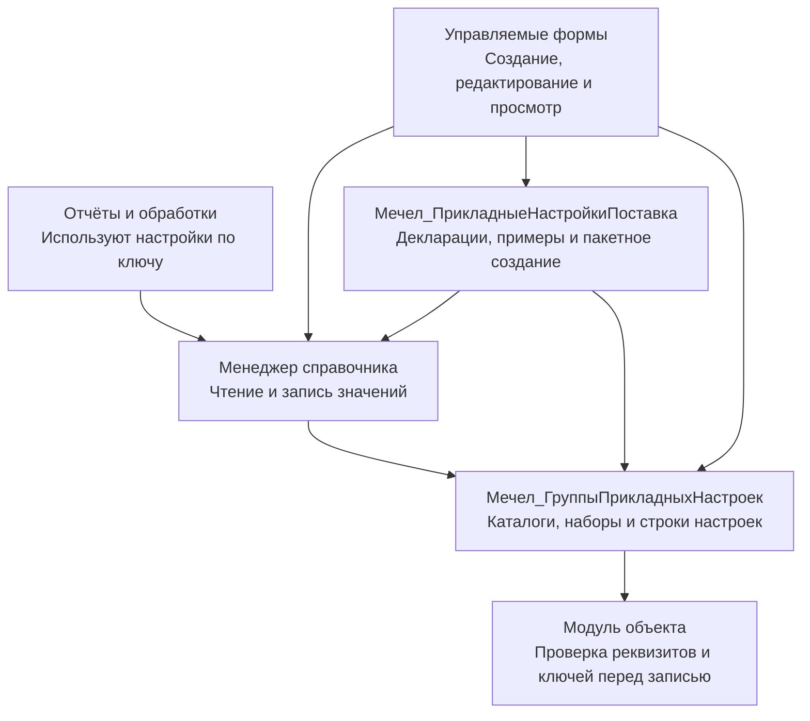

# Прикладные настройки 1.3.0

## Как устроено



**Каталог** организует дерево. Например, в каталоге «Интеграции» может быть каталог «Заказы». **Набор** объединяет связанные настройки. В наборе `ОбменЗаказами` можно хранить число `РазмерПакета` и флажок `ОбменВключен`. **Ключ** состоит из имени набора, точки и имени настройки. Чтобы получить размер пакета, код обращается к ключу `ОбменЗаказами.РазмерПакета`. При переносе набора в другой каталог ключ сохраняется.

| Где лежит код | За что отвечает |
| --- | --- |
| [Модуль менеджера](src/cf/Catalogs/Мечел_ГруппыПрикладныхНастроек/Ext/ManagerModule.bsl) | Читает и записывает значения, хранит встроенные проверки |
| [Модуль объекта](src/cf/Catalogs/Мечел_ГруппыПрикладныхНастроек/Ext/ObjectModule.bsl) | Проверяет реквизиты и уникальность при записи, отслеживает переименование |
| [Мечел_ПрикладныеНастройкиПоставка](src/cf/CommonModules/Мечел_ПрикладныеНастройкиПоставка/Ext/Module.bsl) | Содержит примеры и функцию `ОписанияПрограммныхНастроек`, создаёт только недостающие строки |
| [Формы справочника](src/cf/Catalogs/Мечел_ГруппыПрикладныхНастроек/Forms) | Список, каталог, карточка набора и редактор значения |
| [Общие формы](src/cf/CommonForms) | Просмотр открытых настроек, редактор условий СКД и состояние программных настроек |

## Формы и права

В отдельной конфигурации прикладному администратору назначают **Полные права**, для работы с конфигуратором также требуется **Администратор системы**. При переносе в ERP используйте её стандартные административные роли. Роль добавления и изменения разрешает установить и снять пометку. Читателю доступен просмотр.

| Форма | Назначение | Роль |
| --- | --- | --- |
| Наборы прикладных настроек | Дерево каталогов и наборов, создание, заполнение примеров и проверка поставки | `Мечел_ДобавлениеИзменениеПрикладныхНастроек` |
| Карточка набора | Изменение настроек и запись набора | `Мечел_ДобавлениеИзменениеПрикладныхНастроек` |
| Настройка | Редактор значения, списка и сведений. Открывается из карточки набора | `Мечел_ДобавлениеИзменениеПрикладныхНастроек` |
| Отбор настройки | Таблица условий СКД. Открывается командой **Настроить отбор** | `Мечел_ДобавлениеИзменениеПрикладныхНастроек` |
| Состояние программных настроек | Сравнение деклараций с созданными строками | `Мечел_ДобавлениеИзменениеПрикладныхНастроек` |
| Просмотр прикладных настроек | Общая форма для чтения открытых настроек и просмотра списков | `Мечел_ЧтениеПрикладныхНастроек` |

Читатель открывает **Просмотр прикладных настроек**, выбирает набор и при необходимости нажимает **Показать список значений**. Скрытые строки исключены из этой формы. Редактор видит строку в карточке, где скрытое значение показано как `**`, и может работать с наборами и пометками удаления. Права 1С суммируются. Прямое право **Чтение** справочника открывает скрытые значения через программный интерфейс.

## Работа с формами

### Первое знакомство

1. Откройте **Наборы прикладных настроек** и выберите **Ещё → Заполнить примеры**.
2. Откройте каталог **Примеры**, затем набор **ПримерыНастроек**.
3. Сравните строки с таблицей. На пустой базе их десять. Повторное заполнение сохраняет ваши правки к этим строкам.

| Имя настройки | Значение |
| --- | --- |
| `РазмерПакета` | Число 250 |
| `ОбменВключен` | Булево `Истина` |
| `ДатаНачала` | 1 января 2026 года |
| `Подпись` | Строка «Пример настройки» |
| `ПустаяСтрока` | Строка длиной 0 |
| `НеЗадано` | Сохранённая строка со значением `Неопределено` |
| `СтатусыЗаказов` | Список «Подтвержден», «КОтгрузке» |
| `ПустойСписок` | Список без элементов |
| `ПараметрыОбмена` | Структура с полями `РазмерПакета` и `ПовторятьОшибки` |
| `ОтборЗаказов` | Отбор СКД с группой «ИЛИ» для статуса и суммы |

### Каталоги и наборы

1. Откройте **Наборы прикладных настроек**.
2. Нажмите **Создать каталог**, задайте наименование и нажмите **Записать и закрыть**.
3. Выберите каталог и нажмите **Создать набор**.
4. Укажите уникальное имя набора без точки, до 50 символов.
5. При необходимости измените поле **Каталог** в карточке набора.

Имена наборов уникальны во всём справочнике. Допускаются три вложенных каталога и набор внутри третьего. В пустом списке обе команды создают объект верхнего уровня. Каталог служит для навигации и не входит в программный ключ. Перемещение набора между каталогами сохраняет ключи.

### Создание и запись настройки

1. В карточке набора нажмите **Добавить настройку** и задайте имя без точки, до 200 символов.
2. Откроется редактор **Настройка**. Для существующей строки откройте его командой **Изменить значение…**.
3. В поле **Вид значения** выберите **Обычное значение**, **Список значений** или **Отбор СКД**. Заполните значение. В группе **Сведения о настройке** укажите навигационную ссылку, автора и описание. Нажмите **Применить**.
4. Нажмите **Записать** в карточке набора. **Записать и закрыть** сохраняет набор и закрывает карточку. Кнопка **Отмена** в редакторе новой настройки оставляет список строк без изменений.

Кнопка **Применить** переносит результат в карточку набора. Все изменения набора фиксируются командой **Записать** или **Записать и закрыть**. При изменении только описания, автора или ссылки текущее значение сохраняется. При ошибке заполнения исправьте поля и повторите запись. Закрытие карточки с изменениями вызывает стандартный запрос 1С о сохранении.

| Реквизит строки | Тип | Обязательность |
| --- | --- | --- |
| Описание | Строка до 500 символов | Обязателен |
| Автор | Строка до 150 символов | Обязателен |
| НавигационнаяСсылка | Строка до 500 символов | Обязателен |

Укажите в описании назначение и допустимые значения. В поле автора укажите сотрудника или команду, сопровождающую настройку. Навигационная ссылка может вести на объект 1С или страницу задачи. Команда **Ещё → Перейти по ссылке** открывает ссылку выбранной строки с правами текущего пользователя.

### Списки значений

В редакторе настройки выберите **Вид значения → Список значений**. Добавьте строки, задайте значения и порядок. Нажмите **Применить**, затем **Записать** в карточке набора.

Пустой список сохраняет тип `СписокЗначений`. **Очистить значение** устанавливает `Неопределено`. Списки со значениями серверных типов создавайте программно.

### Переименование и удаление

1. Запишите набор, выберите строку и нажмите **Переименовать…**. Введите новое имя. В вопросе проверьте прежний и новый ключи. **Нет** отменяет переименование.
2. Нажмите **Да**, затем **Записать**. Строка становится оранжевой с отметкой **Приостановлена**. Значение, схема отбора и идентификатор поставки сохраняются. Другие настройки набора продолжают работать. Команда **Переименовать набор** меняет ключи и приостанавливает все ранее записанные строки.
3. Найдите старый ключ в отчётах, обработках, расширениях и регламентных заданиях. Для составного ключа проверьте также код, который соединяет имя набора и имя настройки. Обновите декларацию поставки, сохранив её идентификатор. До подтверждения прежний ключ зарезервирован: попытка создать под ним другую строку будет отклонена. Первый прежний ключ виден в карточке даже после нескольких переименований.
4. Выберите строку, нажмите **Включить после проверки…**, подтвердите и нажмите **Записать**. По новому ключу снова доступно прежнее значение.

| Обращение из прикладного кода после записи нового имени | До включения | После включения |
| --- | --- | --- |
| Чтение по старому ключу | Ключ отсутствует | Ключ отсутствует |
| Чтение по новому ключу без контроля | `Неопределено` | Сохранённое значение |
| Чтение по новому ключу с контролем | Исключение с сообщением о приостановке | Сохранённое значение |
| `ЗначенияНастроекГруппы` | Пропускает строку | Включает строку |
| `УстановитьЗначениеНастройки` по новому ключу | Отклоняет запись | Записывает значение |

После обновления до 1.3.0 это правило действует и для строк, которые уже ожидали проверки. Перед включением проверьте указанный в карточке прежний ключ. Формы просмотра и редактирования показывают приостановленные строки для разбора.

**Ещё → Пометить / снять пометку удаления** меняет состояние выбранной строки. Помеченная строка отображается красным, включая переименованную. Сама пометка удаления сохраняет доступ к значению. Если строка также приостановлена после переименования, действуют правила из таблицы. Повторное заполнение пропускает помеченную строку. Для окончательной очистки запишите набор и выберите **Ещё → Удалить помеченные настройки набора…** на панели строк. Команда доступна пользователю с правом удаления. Предварительно исключите удаляемые ключи из программных деклараций. Каталог или набор помечают стандартной командой списка. В ERP их окончательно удаляет обработка **Удаление помеченных объектов** с контролем ссылок.

Если скопировать набор, его значения перейдут в копию, а декларации останутся связаны с исходным набором. Назовите копию новым уникальным именем.

### Отборы СКД

1. В карточке набора нажмите **Добавить настройку** или **Изменить значение…**. Выберите **Вид значения → Отбор СКД** и нажмите **Настроить отбор…**. Сохранённый отбор можно также открыть напрямую кнопкой **Настроить отбор** в карточке набора.
2. Для нового отбора задайте поля одним из способов ниже и нажмите **Перейти к условиям**. У сохранённого отбора таблица условий открывается сразу.
3. Нажмите **Добавить условие**, выберите **Поле**, **Вид сравнения** и **Значение**. Для ссылочного поля кнопка выбора в колонке **Значение** открывает список соответствующего справочника или документа.
4. Для группировки выделите несколько условий одного уровня. Для соседних строк выделите первую строку и нажмите **Shift+↓**. Нажмите **Сгруппировать…** и выберите **Группа И**, **Группа Или** или **Группа Не**.
5. Нажмите **Применить** в редакторе отбора. Если открывали его из редактора значения, нажмите **Применить** и там. Затем нажмите **Записать** в карточке набора.

#### Откуда берутся поля

| Способ | Какие поля доступны |
| --- | --- |
| **Поля из отчета…** | Поля основной схемы выбранного доступного отчёта. В условиях используйте список колонки **Поле** |
| **Поля объекта…** | Стандартные и обычные реквизиты выбранного справочника, документа, регистра или другого доступного объекта данных. Отметьте нужные поля. Их типы и заголовки заполняются из метаданных |
| **Добавить поле** | Поле с именем из вашей схемы. Заголовок заполняется из имени и его можно отредактировать. Тип по умолчанию **Строка** |

При ручном добавлении поля `Организация` откройте выбор в колонке **Тип значения**, затем **Ссылка на объект конфигурации… → Справочники → Организации**. Команда **Поля объекта…** сразу переносит этот тип из реквизита. Для условия **Организация равно** начните вводить наименование в колонке **Значение** или откройте список командой **Показать все**. Выберите нужную запись. В отборе сохранится ссылка `СправочникСсылка.Организации`.

#### Как дополнить или переименовать поля

Для схемы с полями, заданными в редакторе, нажмите **Изменить поля…**. Добавьте строку или подберите дополнительные поля, затем нажмите **Применить поля**. Существующие условия и группы сохранятся. При переименовании меняется заголовок и обновляются пути к этому полю в условиях. Используемое поле можно удалить или сменить его тип после изменения затронутых условий. Если выбрали отчёт как источник, доступные поля берутся из его схемы СКД. [Редактирование настроек произвольной схемы СКД](https://its.1c.ru/db/content/metod8dev/src/developers/platform/metod/dcs/i8103480.htm)

Пример ручного задания полей для условия «Статус равен “Подтвержден” или сумма больше 100 000».

| Имя поля | Тип значения | Заголовок |
| --- | --- | --- |
| `Статус` | Строка | Статус заказа |
| `Сумма` | Число | Сумма заказа |

Используйте технические имена и типы полей из схемы, к которой будет применён отбор. В примере `ПримерыНастроек.ОтборЗаказов` поля уже заданы. При наличии справочника **Организации** новые демонстрационные настройки используют его ссылочный тип. У ранее созданного примера можно уточнить тип через **Изменить поля…**, если поле пока не участвует в условиях. [Применение отбора в отчёте](#применение-отбора-в-отчёте)

## Создать настройку из кода

Декларация описывает одну будущую настройку. У неё есть ключ, начальное значение, описание, автор, навигационная ссылка и постоянный идентификатор. Для нового набора можно задать путь каталога. Для скрытой настройки передайте `Скрывать = Истина`.

1. Подготовьте декларацию методом [ОписаниеНастройки](#описаниенастройки).
2. Положите её в массив и передайте его в [ОбеспечитьНастройки](#обеспечитьнастройки). Метод вернёт количество новых строк.
3. Прочитайте значение методом [ЗначениеНастройки](#значениенастройки). В этом примере в пустой базе результатом будет `250`.
4. Повторите вызов с тем же массивом. Метод вернёт `0`, а уже записанное значение сохранится.

```bsl
ОписанияНастроек = Новый Массив;
ОписанияНастроек.Добавить(Мечел_ПрикладныеНастройкиПоставка.ОписаниеНастройки(
	"ОбменЗаказами", "РазмерПакета", 250,
	"Количество заказов в пакете выгрузки, от 1 до 1000.",
	"Команда интеграции",
	"e1cib/list/Справочник.Мечел_ГруппыПрикладныхНастроек",
	"Интеграции/Заказы", "ОбменЗаказами.РазмерПакета.v1"));
Создано = Мечел_ПрикладныеНастройкиПоставка.ОбеспечитьНастройки(ОписанияНастроек);
Менеджер = Справочники.Мечел_ГруппыПрикладныхНастроек;
РазмерПакета = Менеджер.ЗначениеНастройки("ОбменЗаказами.РазмерПакета", Истина);
```

Чтобы декларация использовалась при общем программном заполнении, добавьте её в массив `Описания` в функции `ОписанияПрограммныхНастроек`, перед `Возврат Описания`. Процедура `ДобавитьПрограммныеНастройки` берёт декларации из этой функции. Сохраняйте постоянный идентификатор при переименовании. По нему процедура находит ранее созданную строку под новым ключом.

### Узнать, какие настройки уже созданы

В списке наборов нажмите **Состояние поставки**. Для каждой декларации форма показывает её ключ и ключ найденной строки.

| Состояние | Что означает |
| --- | --- |
| Отсутствует | Строки с таким идентификатором и ключом пока нет |
| Создана | Строка найдена по постоянному идентификатору и её ключ совпадает с ожидаемым |
| Есть, создана вручную | Найдена строка с таким ключом без идентификатора поставки. Она сохраняется при заполнении |
| Приостановлена до проверки | Проверьте вызовы и включите строку в карточке набора |
| Переименована | Текущий ключ отличается от ожидаемого |
| Помечена на удаление | Найденная строка сохранила пометку удаления. Заполнение её пропускает |

## Программный интерфейс справочника

Примеры выполняются на сервере. Во всех примерах переменная `Менеджер` содержит менеджер справочника.

```bsl
Менеджер = Справочники.Мечел_ГруппыПрикладныхНастроек;
```

Чтение отсутствующей настройки без контроля возвращает `Неопределено`, с контролем — вызывает исключение. Существующая строка со значением `Неопределено` возвращает его и при включённом контроле. Чтение от имени читателя исключает скрытые настройки.

Простые значения можно читать напрямую. Списки, структуры, таблицы значений, отборы СКД и другие сериализуемые значения хранятся в `ХранилищеЗначения`. Чтобы получить сам объект, передайте `ОткрытьХранилище = Истина`. Этот флаг нужен и для чтения пустой строки. Число `0`, `Ложь`, пустая строка и `Неопределено` сохраняются как разные значения.

### ЗначениеНастройки

Читает значение действующей настройки. Второй параметр включает контроль существования и приостановки, третий раскрывает хранилище.

```bsl
Функция ЗначениеНастройки(Знач ПутьКНастройке, Знач КонтролироватьСуществование = Ложь,
		Знач ОткрытьХранилище = Ложь) Экспорт
```

```bsl
РазмерПакета = Менеджер.ЗначениеНастройки("ОбменЗаказами.РазмерПакета", Истина);
ПараметрыОбмена = Менеджер.ЗначениеНастройки("ПримерыНастроек.ПараметрыОбмена", Истина, Истина);
```

### ЗначенияНастроекГруппы

Читает действующие строки набора одним запросом. Возвращает соответствие имён в сохранённом регистре и значений. Для отсутствующего набора возвращает пустое соответствие.

```bsl
Функция ЗначенияНастроекГруппы(Знач ИмяГруппы, Знач ОткрытьХранилища = Ложь) Экспорт
```

```bsl
Настройки = Менеджер.ЗначенияНастроекГруппы("ОбменЗаказами", Истина);
РазмерПакета = Настройки.Получить("РазмерПакета");
```

### УстановитьЗначениеНастройки

Записывает значение одной настройки. Первые два аргумента задают ключ и значение. Остальные аргументы управляют записью.

| Аргумент | Что делает |
| --- | --- |
| `СоздаватьГруппуПриОтсутствии` | Разрешает создать набор и добавить строку |
| `СоздаватьНастройкуПриОтсутствии` | Разрешает добавить строку в существующий набор |
| `ДопускатьСменуТипа` | Разрешает изменить тип, в том числе сбросить значение в `Неопределено` |
| `КакХранилище` | Сохраняет значение в контейнере даже для простого типа |
| `СтепеньСжатияХранилища` | Целое от 0 до 9, применяемое при записи в контейнер |

При создании этим методом описание формируется из имени, автор берётся из сеанса, ссылка ведёт на набор. Для собственных реквизитов используйте [декларацию](#создать-настройку-из-кода).

```bsl
Процедура УстановитьЗначениеНастройки(Знач ПутьКНастройке, Знач Значение,
		Знач СоздаватьГруппуПриОтсутствии = Ложь, Знач СоздаватьНастройкуПриОтсутствии = Ложь,
		Знач ДопускатьСменуТипа = Ложь, Знач КакХранилище = Ложь, Знач СтепеньСжатияХранилища = 0) Экспорт
```

```bsl
// Создать набор и строку при отсутствии.
Менеджер.УстановитьЗначениеНастройки("ОбменЗаказами.РазмерПакета", 250, Истина);
// Изменить существующее значение.
Менеджер.УстановитьЗначениеНастройки("ОбменЗаказами.РазмерПакета", 500);
// Очистить значение, сохранив строку.
Менеджер.УстановитьЗначениеНастройки("ОбменЗаказами.РазмерПакета", Неопределено, , , Истина);
// Записать структуру в сжатое хранилище.
ПараметрыОбмена = Новый Структура("РазмерПакета", 250);
Менеджер.УстановитьЗначениеНастройки("ОбменЗаказами.Параметры", ПараметрыОбмена, , Истина, , Истина, 6);
```

### СоздатьНедостающиеНастройки

Принимает вложенные структуры или соответствия, включая фиксированные. Во внешней коллекции задайте имена наборов, во внутренней имена настроек и начальные значения. Метод проверяет наличие по имени и возвращает число добавленных строк. Наборы записываются отдельными транзакциями. Если на одном наборе возникнет ошибка, успешные предыдущие записи сохранятся. Для единой транзакции и отслеживания переименований используйте [ОбеспечитьНастройки](#обеспечитьнастройки).

```bsl
Функция СоздатьНедостающиеНастройки(Знач НастройкиПоГруппам) Экспорт
```

```bsl
Начальные = Новый Структура("РазмерПакета, ВыгружатьРезервы", 250, Ложь);
Пакет = Новый Структура("ОбменЗаказами", Начальные);
Создано = Менеджер.СоздатьНедостающиеНастройки(Пакет);
```

### УстановитьЗначениеНастройкиВГруппе

Меняет объект набора в памяти. Вызывающий код отвечает за транзакцию и запись. Разрешение смены типа по умолчанию равно Истина.

```bsl
Процедура УстановитьЗначениеНастройкиВГруппе(ГруппаНастроек, Знач ИмяНастройки, Знач Значение,
		Знач СоздаватьНастройку = Ложь, Знач ДопускатьСменуТипа = Истина,
		Знач КакХранилище = Ложь, Знач СтепеньСжатия = 0) Экспорт
```

```bsl
НачатьТранзакцию();
Попытка
	Менеджер.ЗаблокироватьГруппуНастроек("ОбменЗаказами");
	Набор = Менеджер.НайтиПоНаименованию("ОбменЗаказами", Истина).ПолучитьОбъект();
	Менеджер.УстановитьЗначениеНастройкиВГруппе(Набор, "РазмерПакета", 500);
	Набор.Записать();
	ЗафиксироватьТранзакцию();
Исключение
	ОтменитьТранзакцию();
	ВызватьИсключение;
КонецПопытки;
```

### ЗаблокироватьГруппуНастроек

Блокирует имя в уже начатой транзакции. Блокировка освобождается при завершении транзакции. Полный пример приведён в предыдущем методе.

```bsl
Процедура ЗаблокироватьГруппуНастроек(Знач ИмяГруппы) Экспорт
```

```bsl
Менеджер.ЗаблокироватьГруппуНастроек("ОбменЗаказами");
```

### ЗаполнитьЗначениеСтрокиНастройки

Служебный метод программы пакетного создания. Принимает готовую строку набора и новое значение. Заполняет поля хранения, включая контейнер для сложного значения. Запись набора выполняет вызывающий код. Для изменения существующей настройки с проверкой типа используйте [УстановитьЗначениеНастройки](#установитьзначениенастройки).

```bsl
Процедура ЗаполнитьЗначениеСтрокиНастройки(СтрокаНастройки, Знач ЗначениеНастройки) Экспорт
```

```bsl
Набор = Менеджер.НайтиПоНаименованию("ПримерыНастроек", Истина).ПолучитьОбъект();
СтрокаНастройки = Набор.ЗначенияКонстант.Найти("РазмерПакета", "ИмяКонстанты");
Менеджер.ЗаполнитьЗначениеСтрокиНастройки(СтрокаНастройки, 500);
Набор.Записать();
```

### ИмяНастройкиДопустимо

Возвращает Булево. Проверяет непустую строку и отсутствие точки. Длину проверяют методы записи.

```bsl
Функция ИмяНастройкиДопустимо(Знач Имя) Экспорт
```

```bsl
Допустимо = Менеджер.ИмяНастройкиДопустимо("РазмерПакета");
```

### ИмяДляСравнения

Возвращает строку в верхнем регистре с удалёнными пробелами в конце. Метод используется для поиска совпадающих имён.

```bsl
Функция ИмяДляСравнения(Знач Имя) Экспорт
```

```bsl
КлючСравнения = Менеджер.ИмяДляСравнения("РазмерПакета "); // РАЗМЕРПАКЕТА
```

### ЗначениеНастройкиДляФормы

Принимает строку табличной части. Возвращает значение для показа, маску скрытого значения `**` или представление сложного значения. Выходные параметры `ЭтоСписокЗначений` и `ЭтоОтбор` показывают, какой редактор можно открыть для значения открытой настройки.

```bsl
Функция ЗначениеНастройкиДляФормы(СтрокаНастройки, ЭтоСписокЗначений = Ложь, ЭтоОтбор = Ложь) Экспорт
```

```bsl
Набор = Менеджер.НайтиПоНаименованию("ПримерыНастроек", Истина).ПолучитьОбъект();
СтрокаНастройки = Набор.ЗначенияКонстант.Найти("СтатусыЗаказов", "ИмяКонстанты");
ЭтоСписок = Ложь;
ЭтоОтбор = Ложь;
ПредставлениеЗначения = Менеджер.ЗначениеНастройкиДляФормы(СтрокаНастройки, ЭтоСписок, ЭтоОтбор);
```

### СписокЗначенийДляФормы

Возвращает СписокЗначений из открытой настройки. Для скрытой, отсутствующей, неоднозначной настройки или другого типа возвращает Неопределено.

```bsl
Функция СписокЗначенийДляФормы(Знач ПутьКНастройке) Экспорт
```

```bsl
Список = Менеджер.СписокЗначенийДляФормы("ПримерыНастроек.СтатусыЗаказов");
```

### ИменаГруппОткрытыхНастроек

Возвращает массив имён наборов, у которых есть открытые строки.

```bsl
Функция ИменаГруппОткрытыхНастроек() Экспорт
```

```bsl
ИменаНаборов = Менеджер.ИменаГруппОткрытыхНастроек();
```

### ОткрытыеНастройкиДляПросмотра

Возвращает таблицу с колонками КлючНастройки, ПредставлениеЗначения, ЭтоСписокЗначений, Описание, Автор, НавигационнаяСсылка, ПредыдущийКлюч, ТребуетсяПроверкаВызовов, ПометкаУдаления.

```bsl
Функция ОткрытыеНастройкиДляПросмотра(Знач ИмяГруппы) Экспорт
```

```bsl
ТаблицаПросмотра = Менеджер.ОткрытыеНастройкиДляПросмотра("ПримерыНастроек");
```

### ВыполнитьТесты

Проверяет значения, списки, пакетное создание, переименование и отказы записи. Тестовые изменения откатываются, при ошибке возникает исключение.

```bsl
Процедура ВыполнитьТесты() Экспорт
```

```bsl
Менеджер.ВыполнитьТесты();
```

## Интерфейс программной поставки

Все методы вызываются на сервере через `Мечел_ПрикладныеНастройкиПоставка`.

### ОписаниеНастройки

Возвращает структуру декларации. Запись происходит при вызове `ОбеспечитьНастройки`.

| Аргумент | Что передать |
| --- | --- |
| `Набор`, `Имя` | Имя набора до 50 символов и имя настройки до 200 символов. Используйте имена без точки |
| `Значение` | Начальное значение, в том числе `Неопределено` |
| `Описание`, `Автор`, `НавигационнаяСсылка` | Назначение до 500, автор до 150 и ссылка до 500 символов |
| `Каталог` | Путь к каталогу через `/`. Пустой путь означает корень. Путь применяется при создании набора |
| `ИдентификаторПоставки` | Постоянный идентификатор до 100 символов. По умолчанию равен ключу. Для более длинного ключа задайте короткий идентификатор явно |
| `СхемаОтбора` | Объект `СхемаКомпоновкиДанных` для редактора отбора или `Неопределено` |
| `Скрывать` | `Истина` исключает новую строку из просмотра для читателей, значение по умолчанию `Ложь` |

```bsl
Функция ОписаниеНастройки(Знач Набор, Знач Имя, Знач Значение, Знач Описание, Знач Автор,
		Знач НавигационнаяСсылка, Знач Каталог = "", Знач ИдентификаторПоставки = "",
		Знач СхемаОтбора = Неопределено, Знач Скрывать = Ложь) Экспорт
```

```bsl
Описание = Мечел_ПрикладныеНастройкиПоставка.ОписаниеНастройки("ОбменЗаказами", "РазмерПакета", 250,
	"Число заказов в пакете", "Команда интеграции",
	"e1cib/list/Справочник.Мечел_ГруппыПрикладныхНастроек",
	"Интеграции/Заказы", "ОбменЗаказами.РазмерПакета.v1");
```

Для скрытой строки укажите `Истина` последним аргументом. В этом примере схема отбора опущена.

```bsl
ОписаниеСкрытой = Мечел_ПрикладныеНастройкиПоставка.ОписаниеНастройки(
	"ОбменЗаказами", "ВнутреннийРежим", Ложь, "Разрешить служебный режим обмена", "Команда интеграции",
	"e1cib/list/Справочник.Мечел_ГруппыПрикладныхНастроек",
	"Интеграции/Заказы", "ОбменЗаказами.ВнутреннийРежим.v1", , Истина);
```

### ОбеспечитьНастройки

Принимает массив деклараций и возвращает число добавленных настроек. Находит существующие строки по идентификатору поставки или ключу. Добавляет остальные и записывает каждый изменённый набор один раз. При повторном вызове сохраняет записанные значения, реквизиты, признаки скрытия и пометки. Конфликт ключа с другой декларацией откатывает весь вызов. Требуется право изменения.

```bsl
Функция ОбеспечитьНастройки(Описания) Экспорт
```

```bsl
Описания = Новый Массив;
Описания.Добавить(Описание);
Создано = Мечел_ПрикладныеНастройкиПоставка.ОбеспечитьНастройки(Описания);
```

### СостояниеНастроек

Возвращает таблицу с колонками ИдентификаторПоставки, ОжидаемыйКлюч, ТекущийКлюч и Состояние. Читает идентификаторы и ключи одним запросом, без значений. Требует права изменения.

```bsl
Функция СостояниеНастроек(Описания) Экспорт
```

```bsl
ОписанияНастроек = Мечел_ПрикладныеНастройкиПоставка.ОписанияПрограммныхНастроек();
ТаблицаСостояний = Мечел_ПрикладныеНастройкиПоставка.СостояниеНастроек(ОписанияНастроек);
```

### ОписанияПримеров

Возвращает массив десяти демонстрационных деклараций набора ПримерыНастроек.

```bsl
Функция ОписанияПримеров() Экспорт
```

```bsl
Примеры = Мечел_ПрикладныеНастройкиПоставка.ОписанияПримеров();
```

### ДобавитьПримеры

Создаёт демонстрационные строки и возвращает число добавленных. Повторный запуск сохраняет пользовательские значения.

```bsl
Функция ДобавитьПримеры() Экспорт
```

```bsl
СозданоПримеров = Мечел_ПрикладныеНастройкиПоставка.ДобавитьПримеры();
```

### ДобавитьПрограммныеНастройки

Процедура обработчика обновления БСП. Обновляет реквизиты старых строк и передаёт текущие декларации в ОбеспечитьНастройки.

```bsl
Процедура ДобавитьПрограммныеНастройки() Экспорт
```

```bsl
Мечел_ПрикладныеНастройкиПоставка.ДобавитьПрограммныеНастройки();
```

### ОбновитьРеквизитыНастроек

Подготавливает строки с незаполненным идентификатором после обновления с версии 1.1.1. Возвращает число обновлённых наборов. Каждый набор записывается отдельной транзакцией. Повторный вызов пропускает подготовленные строки.

```bsl
Функция ОбновитьРеквизитыНастроек() Экспорт
```

```bsl
ОбновленоНаборов = Мечел_ПрикладныеНастройкиПоставка.ОбновитьРеквизитыНастроек();
```

### ОписанияПрограммныхНастроек

Возвращает массив деклараций текущей поставки. Добавляйте прикладные декларации в тело этой функции. Исходная поставка включает демонстрационные настройки.

```bsl
Функция ОписанияПрограммныхНастроек() Экспорт
```

```bsl
Описания = Мечел_ПрикладныеНастройкиПоставка.ОписанияПрограммныхНастроек();
```

## Прикладные примеры

### Список для запроса

Получите список с раскрытием хранилища и передайте массив в параметр запроса. В примере поле `Статус` содержит строковые коды. Для ссылочного поля используйте список ссылок соответствующего типа.

```bsl
Статусы = Менеджер.ЗначениеНастройки("ПримерыНастроек.СтатусыЗаказов", Истина, Истина);
ЗапросЗаказов.УстановитьПараметр("Статусы", Статусы.ВыгрузитьЗначения());
// В запросе используется условие Статус В (&Статусы).
```

### Запись списка

```bsl
Статусы = Новый СписокЗначений;
Статусы.Добавить("Подтвержден");
Статусы.Добавить("КОтгрузке");
Менеджер.УстановитьЗначениеНастройки("ОбменЗаказами.Статусы", Статусы, Истина);
```

### Подготовить условия отбора

Сначала создайте объект отбора. Пример задаёт условие «Статус равен “Подтвержден” или сумма больше 100 000». Следующий шаг сохраняет этот объект вместе со схемой полей.

```bsl
ОтборЗаказов = Новый ОтборКомпоновкиДанных;
ГруппаУсловий = ОтборЗаказов.Элементы.Добавить(Тип("ГруппаЭлементовОтбораКомпоновкиДанных"));
ГруппаУсловий.ТипГруппы = ТипГруппыЭлементовОтбораКомпоновкиДанных.ГруппаИли;
ГруппаУсловий.Использование = Истина;
Условие = ГруппаУсловий.Элементы.Добавить(Тип("ЭлементОтбораКомпоновкиДанных"));
Условие.ЛевоеЗначение = Новый ПолеКомпоновкиДанных("Статус");
Условие.ВидСравнения = ВидСравненияКомпоновкиДанных.Равно;
Условие.ПравоеЗначение = "Подтвержден";
Условие.Использование = Истина;
Условие = ГруппаУсловий.Элементы.Добавить(Тип("ЭлементОтбораКомпоновкиДанных"));
Условие.ЛевоеЗначение = Новый ПолеКомпоновкиДанных("Сумма");
Условие.ВидСравнения = ВидСравненияКомпоновкиДанных.Больше;
Условие.ПравоеЗначение = 100000;
Условие.Использование = Истина;
```

### Сохранить условия со схемой отчёта

Возьмите `ОтборЗаказов` из предыдущего шага. Замените `ЗаказыКВыгрузке` на имя своего отчёта. Проверьте, что в его основной схеме есть поля `Статус` и `Сумма` нужных типов. Затем создайте декларацию и добавьте её в справочник.

```bsl
ИмяМакетаСКД = Метаданные.Отчеты.ЗаказыКВыгрузке.ОсновнаяСхемаКомпоновкиДанных.Имя;
СхемаОтчета = Отчеты.ЗаказыКВыгрузке.ПолучитьМакет(ИмяМакетаСКД);
Описание = Мечел_ПрикладныеНастройкиПоставка.ОписаниеНастройки("ОбменЗаказами", "ОтборЗаказов", ОтборЗаказов,
	"Правила отбора заказов", "Команда интеграции",
	"e1cib/list/Справочник.Мечел_ГруппыПрикладныхНастроек",
	"Интеграции/Заказы", "ОбменЗаказами.ОтборЗаказов.v1", СхемаОтчета);
Описания = Новый Массив;
Описания.Добавить(Описание);
Создано = Мечел_ПрикладныеНастройкиПоставка.ОбеспечитьНастройки(Описания);
```

Для существующей строки `ОбеспечитьНастройки` сохраняет её схему и значение. Чтобы изменить отбор, откройте **Настроить отбор** в карточке. При замене схемы проверьте имена и типы полей сохранённых условий.

### Применение отбора в отчёте

В этом примере отчёт использует набор данных «Запрос». Его схема предоставляет поля `Статус` типа Строка и `Сумма` типа Число. Нажмите **Ещё → Заполнить примеры** в списке наборов, чтобы появился ключ `ПримерыНастроек.ОтборЗаказов`. Для своего отчёта подставьте ключ настройки, созданной по его схеме. Условия используют пути к полям СКД, включая псевдонимы запроса.

**1. Добавьте в модуль объекта отчёта две служебные процедуры.** Первая читает обязательную настройку. Вторая переносит дерево условий вместе с группами И, ИЛИ и НЕ. Настройки пользователя и отключённые условия сохраняются. Если ключ неверен, приостановлен или содержит значение другого типа, формирование остановится с сообщением. Это важно для отбора, который ограничивает состав выгрузки.

```bsl
Процедура ДобавитьОтборНастройки(НастройкиВывода, КлючНастройки)
	МенеджерНастроек = Справочники.Мечел_ГруппыПрикладныхНастроек;
	ОтборНастройки = МенеджерНастроек.ЗначениеНастройки(КлючНастройки, Истина, Истина);
	Если ТипЗнч(ОтборНастройки) <> Тип("ОтборКомпоновкиДанных") Тогда
		ВызватьИсключение СтрШаблон("Настройка «%1» должна содержать отбор СКД.", КлючНастройки);
	КонецЕсли;
	ПеренестиУсловияОтбора(ОтборНастройки.Элементы, НастройкиВывода.Отбор.Элементы);
КонецПроцедуры

Процедура ПеренестиУсловияОтбора(УсловияИсточника, УсловияПриемника)
	Для Каждого Условие Из УсловияИсточника Цикл
		УсловиеОтчета = УсловияПриемника.Добавить(ТипЗнч(Условие));
		Если ТипЗнч(Условие) = Тип("ГруппаЭлементовОтбораКомпоновкиДанных") Тогда
			ЗаполнитьЗначенияСвойств(УсловиеОтчета, Условие, "Использование,ТипГруппы");
			ПеренестиУсловияОтбора(Условие.Элементы, УсловиеОтчета.Элементы);
		Иначе
			ЗаполнитьЗначенияСвойств(УсловиеОтчета, Условие,
				"Использование,ЛевоеЗначение,ВидСравнения,ПравоеЗначение");
		КонецЕсли;
	КонецЦикла;
КонецПроцедуры
```

**2. Подключите отбор при формировании.** В модуле объекта простого отчёта с макетом `ОсновнаяСхемаКомпоновкиДанных` используйте обработчик ниже. Если отчёт ERP уже формирует результат своим обработчиком, добавьте вызов `ДобавитьОтборНастройки` к его итоговым настройкам непосредственно перед построением макета. Существующую логику отчёта сохраните.

```bsl
Процедура ПриКомпоновкеРезультата(ДокументРезультат, ДанныеРасшифровки, СтандартнаяОбработка)
	СтандартнаяОбработка = Ложь;
	СхемаОтчета = ПолучитьМакет("ОсновнаяСхемаКомпоновкиДанных");
	НастройкиВывода = КомпоновщикНастроек.ПолучитьНастройки();
	ДобавитьОтборНастройки(НастройкиВывода, "ПримерыНастроек.ОтборЗаказов");

	КомпоновщикМакета = Новый КомпоновщикМакетаКомпоновкиДанных;
	МакетВывода = КомпоновщикМакета.Выполнить(СхемаОтчета, НастройкиВывода, ДанныеРасшифровки);
	ПроцессорДанных = Новый ПроцессорКомпоновкиДанных;
	ПроцессорДанных.Инициализировать(МакетВывода, , ДанныеРасшифровки);
	ВыводДокумента = Новый ПроцессорВыводаРезультатаКомпоновкиДанныхВТабличныйДокумент;
	ДокументРезультат.Очистить();
	ВыводДокумента.УстановитьДокумент(ДокументРезультат);
	ВыводДокумента.Вывести(ПроцессорДанных);
КонецПроцедуры
```

**3. Проверьте результат.** Выведите детальные записи с полями `Статус` и `Сумма`. Для исходного демонстрационного отбора ожидаются такие результаты.

| Статус | Сумма | В отчёте | Причина |
| --- | ---: | --- | --- |
| Подтвержден | 500 | Да | Совпал статус |
| Черновик | 120 000 | Да | Сумма больше порога |
| Черновик | 100 000 | Нет | Сравнение строгое |

Если пользователь дополнительно указал `Сумма > 1 000`, останется только вторая запись. Повторное нажатие **Сформировать** даёт тот же результат. На каждое формирование обработчик получает итоговые настройки заново. [Устройство системы компоновки данных](https://1c-dn.com/1c_enterprise/data_composition_system/)

### Применить тот же отбор в серверной обработке

Выгрузке может понадобиться таблица для дальнейшей обработки. Разместите обе процедуры из шага 1 в серверном модуле обработки или общем модуле, доступном отчёту и обработке. Следующая функция принимает схему с набором «Запрос», выбранными полями и группировкой «Детальные записи». Для этой функции варианты пользователя не нужны, она загружает настройки схемы по умолчанию.

```bsl
Функция СтрокиДляВыгрузки(СхемаОтчета, КлючНастройки)
	ИсточникНастроек = Новый ИсточникДоступныхНастроекКомпоновкиДанных(СхемаОтчета);
	Компоновщик = Новый КомпоновщикНастроекКомпоновкиДанных;
	Компоновщик.Инициализировать(ИсточникНастроек);
	Компоновщик.ЗагрузитьНастройки(СхемаОтчета.НастройкиПоУмолчанию);
	НастройкиВывода = Компоновщик.ПолучитьНастройки();
	ДобавитьОтборНастройки(НастройкиВывода, КлючНастройки);

	КомпоновщикМакета = Новый КомпоновщикМакетаКомпоновкиДанных;
	МакетВывода = КомпоновщикМакета.Выполнить(СхемаОтчета, НастройкиВывода, , ,
		Тип("ГенераторМакетаКомпоновкиДанныхДляКоллекцииЗначений"));
	ПроцессорДанных = Новый ПроцессорКомпоновкиДанных;
	ПроцессорДанных.Инициализировать(МакетВывода);
	СтрокиВыгрузки = Новый ТаблицаЗначений;
	ВыводТаблицы = Новый ПроцессорВыводаРезультатаКомпоновкиДанныхВКоллекциюЗначений;
	ВыводТаблицы.УстановитьОбъект(СтрокиВыгрузки);
	ВыводТаблицы.Вывести(ПроцессорДанных);
	Возврат СтрокиВыгрузки;
КонецФункции
```

В серверной процедуре получения данных вызовите функцию так. Имя отчёта замените на имя из своей конфигурации.

```bsl
СхемаОтчета = Отчеты.ЗаказыКВыгрузке.ПолучитьМакет("ОсновнаяСхемаКомпоновкиДанных");
ТаблицаЗаказов = СтрокиДляВыгрузки(СхемаОтчета, "ПримерыНастроек.ОтборЗаказов");
```

### Добавить к отбору конкретную организацию

Примените этот фрагмент в отчёте или обработке после вызова `ДобавитьОтборНастройки` и до построения макета. В схеме должно быть поле `Организация` типа `СправочникСсылка.Организации`. Параметр `ОрганизацияДляОтчета` получает ссылку из реквизита формы выбора организации.

```bsl
Если ЗначениеЗаполнено(ОрганизацияДляОтчета) Тогда
	ПоОрганизации = НастройкиВывода.Отбор.Элементы.Добавить(Тип("ЭлементОтбораКомпоновкиДанных"));
	ПоОрганизации.Использование = Истина;
	ПоОрганизации.ЛевоеЗначение = Новый ПолеКомпоновкиДанных("Организация");
	ПоОрганизации.ВидСравнения = ВидСравненияКомпоновкиДанных.Равно;
	ПоОрганизации.ПравоеЗначение = ОрганизацияДляОтчета;
КонецЕсли;
```

При заполненной организации результат соответствует выражению `(Статус = "Подтвержден" ИЛИ Сумма > 100000) И Организация = выбранная ссылка`. При пустом параметре останутся условия сохранённого отбора. Условие организации действует только для текущего формирования.

### Навигационная ссылка

Получите внутреннюю ссылку от ссылки на объект. В карточке выберите строку и нажмите **Ещё → Перейти по ссылке**. Платформа проверяет права на целевой объект.

```bsl
СсылкаНаНабор = Менеджер.НайтиПоНаименованию("ОбменЗаказами", Истина);
НавигационнаяСсылка = ПолучитьНавигационнуюСсылку(СсылкаНаНабор);
```

## Проверка

В списке наборов выберите **Ещё → Проверить работу**. После успешного прогона появится сообщение «Проверка прикладных настроек завершена. Все тесты пройдены». Тестовые записи откатываются. При ошибке сообщение указывает, какая проверка завершилась сбоем.
