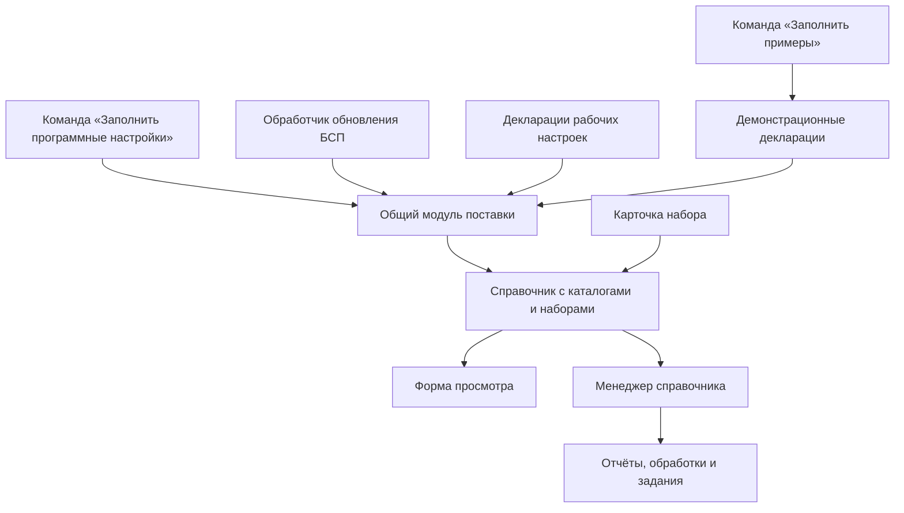

# Прикладные настройки 1.3.0

Справочник хранит значения, которые отчёты, обработки и задания получают по имени. Например, настройка `ОбменЗаказами.РазмерПакета` задаёт, сколько заказов обработать за один раз. Значение можно изменить в 1С, а код продолжит обращаться к тому же ключу.

[Работа в 1С](#работа-с-формами) · [Добавление из кода](#создать-настройку-из-кода) · [Примеры по типам](#примеры-рабочих-настроек-по-типам) · [Методы справочника](#программный-интерфейс-справочника) · [Отборы в отчётах](#применение-отбора-в-отчёте)

## Как всё устроено



В списке видны каталоги и наборы. Строки настроек открываются в карточке набора.

```text
Интеграции                 каталог
└── Заказы                 вложенный каталог
    └── ОбменЗаказами      набор
        ├── РазмерПакета   настройка со значением 250
        └── ОбменВключен   настройка со значением Истина
```

Каталог помогает найти набор. Набор объединяет настройки по одной задаче. Для обращения из кода используется **ключ** `Набор.ИмяНастройки`, например `ОбменЗаказами.РазмерПакета`. Путь к каталогу в ключ не входит.

**Декларация** — описание настройки в коде. В ней заданы начальное значение и сведения для записи. **Идентификатор поставки** связывает декларацию с созданной строкой. Он позволяет найти её после переименования.

| Где смотреть | Что делает |
| --- | --- |
| [Мечел_ПрикладныеНастройкиДобавление](src/cf/CommonModules/Мечел_ПрикладныеНастройкиДобавление/Ext/Module.bsl) | Содержит рабочие и демонстрационные настройки. Новую рабочую функцию добавляют здесь |
| [Мечел_ПрикладныеНастройкиПоставка](src/cf/CommonModules/Мечел_ПрикладныеНастройкиПоставка/Ext/Module.bsl) | Собирает описания, создаёт недостающие строки и показывает состояние заполнения |
| [Менеджер справочника](src/cf/Catalogs/Мечел_ГруппыПрикладныхНастроек/Ext/ManagerModule.bsl) | Читает и записывает значения по ключу |
| [Модуль объекта](src/cf/Catalogs/Мечел_ГруппыПрикладныхНастроек/Ext/ObjectModule.bsl) | Проверяет набор и его строки при записи, отмечает изменения ключей |
| [Формы справочника](src/cf/Catalogs/Мечел_ГруппыПрикладныхНастроек/Forms) и [общие формы](src/cf/CommonForms) | Дают доступ к списку, карточкам, редактору отбора, просмотру и состоянию поставки |

## Формы и права

В отдельной конфигурации прикладному администратору назначают **Полные права**, для работы с конфигуратором также требуется **Администратор системы**. При переносе в ERP используйте её стандартные административные роли. Редактор может установить и снять пометку удаления. Читателю доступен просмотр.

| Форма | Назначение | Роль |
| --- | --- | --- |
| Наборы прикладных настроек | Дерево каталогов и наборов, ручное заполнение и проверка поставки | `Мечел_ДобавлениеИзменениеПрикладныхНастроек` |
| Карточка набора | Изменение настроек и запись набора | `Мечел_ДобавлениеИзменениеПрикладныхНастроек` |
| Настройка | Редактор значения, списка и сведений. Открывается из карточки набора | `Мечел_ДобавлениеИзменениеПрикладныхНастроек` |
| Отбор настройки | Таблица условий СКД. Открывается командой **Настроить отбор** | `Мечел_ДобавлениеИзменениеПрикладныхНастроек` |
| Состояние программных настроек | Сравнение деклараций с созданными строками | `Мечел_ДобавлениеИзменениеПрикладныхНастроек` |
| Просмотр прикладных настроек | Общая форма для чтения открытых настроек и просмотра списков | `Мечел_ЧтениеПрикладныхНастроек` |

Читатель открывает **Просмотр прикладных настроек**, выбирает набор и может раскрыть список или перейти по ссылке выбранной строки. Скрытые строки исключены из этой формы. Редактор видит строку в карточке, где скрытое значение показано как `**`, и может работать с наборами и пометками удаления. Права 1С суммируются. Прямое право **Чтение** справочника открывает скрытые значения через программный интерфейс.

## Работа с формами

### Первое знакомство

1. Откройте **Наборы прикладных настроек** и выберите **Ещё → Заполнить примеры**.
2. Откройте каталог **Примеры**, затем набор **ПримерыНастроек**.
3. Сравните строки с таблицей. Если примеров ещё нет, команда добавит десять строк. При повторном запуске сообщение покажет 0, а внесённые правки сохранятся.

| Имя настройки | Значение |
| --- | --- |
| `РазмерПакета` | Число 250 |
| `ОбменВключен` | Булево `Истина` |
| `ДатаНачала` | 1 января 2026 года |
| `Подпись` | Строка «Пример настройки» |
| `ПустаяСтрока` | Строка длиной 0 |
| `НеЗадано` | Сохранённая строка со значением `Неопределено` |
| `СтатусыЗаказов` | Список «Подтвержден», «КОтгрузке» |
| `ПустойСписок` | Список без элементов |
| `ПараметрыОбмена` | Структура с полями `РазмерПакета` и `ПовторятьОшибки` |
| `ОтборЗаказов` | Отбор СКД с группой «ИЛИ» для статуса и суммы |

### Каталоги и наборы

1. Откройте **Наборы прикладных настроек**.
2. Нажмите **Создать каталог**, задайте наименование и нажмите **Записать и закрыть**.
3. Выберите каталог и нажмите **Создать набор**.
4. Укажите уникальное имя набора без точки, до 50 символов.
5. При необходимости измените поле **Каталог** в карточке набора.

Имена наборов уникальны во всём справочнике. Допускаются три вложенных каталога и набор внутри третьего. В пустом списке обе команды создают объект верхнего уровня. Каталог служит для навигации и не входит в программный ключ. Перемещение набора между каталогами сохраняет ключи.

### Создание и запись настройки

1. В карточке набора нажмите **Добавить настройку** и задайте имя без точки, до 200 символов.
2. Откроется редактор **Настройка**. Для существующей строки откройте его командой **Изменить значение…**.
3. В поле **Вид значения** выберите **Обычное значение**, **Список значений** или **Отбор СКД**. Заполните значение. В группе **Сведения о настройке** укажите навигационную ссылку, автора и описание. Нажмите **Применить**.
4. Нажмите **Записать** в карточке набора. **Записать и закрыть** сохраняет набор и закрывает карточку. Кнопка **Отмена** в редакторе новой настройки оставляет список строк без изменений.

Кнопка **Применить** переносит результат в карточку набора. Все изменения набора фиксируются командой **Записать** или **Записать и закрыть**. При изменении только описания, автора или ссылки текущее значение сохраняется. При ошибке заполнения исправьте поля и повторите запись. Закрытие карточки с изменениями вызывает стандартный запрос 1С о сохранении.

| Реквизит строки | Тип | Обязательность |
| --- | --- | --- |
| Описание | Строка до 500 символов | Обязателен |
| Автор | Строка до 150 символов | Обязателен |
| НавигационнаяСсылка | Строка до 500 символов | Обязателен |

Укажите в описании назначение и допустимые значения. В поле автора укажите сотрудника или команду, сопровождающую настройку. В поле ссылки укажите объект 1С или технический проект. В карточке набора ссылка открывается через **Ещё → Перейти по ссылке**, а в форме просмотра — кнопкой **Перейти по ссылке** над таблицей. В обоих случаях действуют права текущего пользователя.

### Списки значений

В редакторе настройки выберите **Вид значения → Список значений**. Добавьте строки, задайте значения и порядок. Нажмите **Применить**, затем **Записать** в карточке набора.

Пустой список сохраняет тип `СписокЗначений`. **Очистить значение** устанавливает `Неопределено`. Списки со значениями серверных типов создавайте программно.

### Переименование и удаление

1. Запишите набор, выберите строку и нажмите **Переименовать…**. Введите новое имя. В вопросе проверьте прежний и новый ключи. **Нет** отменяет переименование.
2. Нажмите **Да**, затем **Записать**. Строка становится оранжевой с отметкой **Приостановлена**. Значение, схема отбора и идентификатор поставки сохраняются. Другие настройки набора продолжают работать. Команда **Переименовать набор** меняет ключи и приостанавливает все ранее записанные строки.
3. Найдите старый ключ в отчётах, обработках, расширениях и регламентных заданиях. Для составного ключа проверьте также код, который соединяет имя набора и имя настройки. Обновите декларацию поставки, сохранив её идентификатор. До подтверждения система отклоняет попытку создать другую строку под прежним ключом. Первый прежний ключ виден в карточке даже после нескольких переименований.
4. Выберите строку, нажмите **Включить после проверки…**, подтвердите и нажмите **Записать**. По новому ключу снова доступно прежнее значение.

| Обращение из прикладного кода после записи нового имени | До включения | После включения |
| --- | --- | --- |
| Чтение по старому ключу | Ключ отсутствует | Ключ отсутствует |
| Чтение по новому ключу без контроля | `Неопределено` | Сохранённое значение |
| Чтение по новому ключу с контролем | Исключение с сообщением о приостановке | Сохранённое значение |
| `ЗначенияНастроекГруппы` | Пропускает строку | Включает строку |
| `УстановитьЗначениеНастройки` по новому ключу | Отклоняет запись | Записывает значение |

После обновления до 1.3.0 это правило действует и для строк, которые уже ожидали проверки. Перед включением проверьте указанный в карточке прежний ключ. Формы просмотра и редактирования показывают приостановленные строки для разбора. В форме просмотра предупреждение появляется над таблицей при выборе затронутого набора.

**Ещё → Пометить / снять пометку удаления** меняет состояние выбранной строки. Помеченная строка отображается красным, включая переименованную. Сама пометка удаления сохраняет доступ к значению. Если строка также приостановлена после переименования, действуют правила из таблицы. Повторное заполнение пропускает помеченную строку. Для окончательной очистки запишите набор и выберите **Ещё → Удалить помеченные настройки набора…** на панели строк. Команда доступна пользователю с правом удаления. Если настройка есть в рабочем списке, сначала исключите её декларацию из кода. Каталог или набор помечают стандартной командой списка. В ERP их окончательно удаляет обработка **Удаление помеченных объектов** с контролем ссылок.

Если скопировать набор, его значения перейдут в копию, а декларации останутся связаны с исходным набором. Назовите копию новым уникальным именем.

### Отборы СКД

1. В карточке набора нажмите **Добавить настройку** или **Изменить значение…**. Выберите **Вид значения → Отбор СКД** и нажмите **Настроить отбор…**. Сохранённый отбор можно также открыть напрямую кнопкой **Настроить отбор** в карточке набора.
2. Для нового отбора задайте поля одним из способов ниже и нажмите **Перейти к условиям**. У сохранённого отбора таблица условий открывается сразу.
3. Нажмите **Добавить условие**, выберите **Поле**, **Вид сравнения** и **Значение**. Для ссылочного поля кнопка выбора в колонке **Значение** открывает список соответствующего справочника или документа.
4. Для группировки выделите несколько условий одного уровня. Для соседних строк выделите первую строку и нажмите **Shift+↓**. Нажмите **Сгруппировать…** и выберите **Группа И**, **Группа Или** или **Группа Не**.
5. Нажмите **Применить** в редакторе отбора. Если открывали его из редактора значения, нажмите **Применить** и там. Затем нажмите **Записать** в карточке набора.

#### Откуда берутся поля

| Способ | Какие поля доступны |
| --- | --- |
| **Поля из отчета…** | Поля основной схемы выбранного доступного отчёта. В условиях используйте список колонки **Поле** |
| **Поля объекта…** | Стандартные и обычные реквизиты выбранного справочника, документа, регистра или другого доступного объекта данных. Отметьте нужные поля. Их типы и заголовки заполняются из метаданных |
| **Добавить поле** | Поле с именем из вашей схемы. Заголовок заполняется из имени и его можно отредактировать. Тип по умолчанию **Строка** |

При ручном добавлении поля `Организация` откройте выбор в колонке **Тип значения**, затем **Ссылка на объект конфигурации… → Справочники → Организации**. Команда **Поля объекта…** сразу переносит этот тип из реквизита. Для условия **Организация равно** начните вводить наименование в колонке **Значение** или откройте список командой **Показать все**. Выберите нужную запись. В отборе сохранится ссылка `СправочникСсылка.Организации`.

#### Как дополнить или переименовать поля

Для схемы с полями, заданными в редакторе, нажмите **Изменить поля…**. Добавьте строку или подберите дополнительные поля, затем нажмите **Применить поля**. Существующие условия и группы сохранятся. При переименовании меняется заголовок и обновляются пути к этому полю в условиях. Используемое поле можно удалить или сменить его тип после изменения затронутых условий. Если выбрали отчёт как источник, доступные поля берутся из его схемы СКД. [Редактирование настроек произвольной схемы СКД](https://its.1c.ru/db/content/metod8dev/src/developers/platform/metod/dcs/i8103480.htm)

Пример ручного задания полей для условия «Статус равен “Подтвержден” или сумма больше 100 000».

| Имя поля | Тип значения | Заголовок |
| --- | --- | --- |
| `Статус` | Строка | Статус заказа |
| `Сумма` | Число | Сумма заказа |

Используйте технические имена и типы полей из схемы, к которой будет применён отбор. В примере `ПримерыНастроек.ОтборЗаказов` поля уже заданы. При наличии справочника **Организации** новые демонстрационные настройки используют его ссылочный тип. У ранее созданного примера можно уточнить тип через **Изменить поля…**, если поле пока не участвует в условиях. [Применение отбора в отчёте](#применение-отбора-в-отчёте)

## Создать настройку из кода

Рабочие настройки добавляйте в общий модуль `Мечел_ПрикладныеНастройкиДобавление`. Одна функция описывает одну настройку. В функцию `ДекларацииСозданияНастроек()` добавляется вызов новой функции, который возвращает описание для заполнения.

### Шаг 1. Опишите настройку

В раздел рабочих настроек модуля `Мечел_ПрикладныеНастройкиДобавление` добавьте эту функцию. Она задаёт начальный размер пакета в 250 заказов.

```bsl
Функция РазмерПакетаЗаказов()

	Возврат ОписаниеРабочейНастройки("ОбменЗаказами", "РазмерПакета", 250,
		"Количество заказов в одном пакете выгрузки.",
		"Команда интеграции", "e1cib/navigationpoint/startpage", "Интеграции/Заказы");

КонецФункции
```

В примерах `e1cib/navigationpoint/startpage` обозначает начальную страницу. Для рабочей настройки укажите навигационную ссылку на её технический проект или объект 1С. `ОписаниеРабочейНастройки()` добавляет адрес базы технических проектов только к ссылкам, начинающимся с `e1cib/`. Полный адрес передаётся как есть.

Аргументы `ОписаниеРабочейНастройки()` идут в таком порядке:

| Аргумент | Что указать |
| --- | --- |
| `Набор` | Имя набора до 50 символов. Оно уникально во всём справочнике |
| `Имя` | Имя настройки до 200 символов. Оно уникально внутри набора |
| `Значение` | Начальное значение нужного типа |
| `Описание` | Назначение настройки в пределах 500 символов |
| `Автор` | Ответственный сотрудник или команда, до 150 символов |
| `НавигационнаяСсылка` | Ссылка на объект 1С или технический проект, до 500 символов с учётом добавленного адреса |
| `Каталог` | Необязательный путь, например `Интеграции/Заказы`. Используется при создании набора. Пустая строка создаёт новый набор на верхнем уровне |

В именах набора и настройки используйте слова без точки. В ключе точка разделяет эти два имени.

### Шаг 2. Добавьте функцию в список заполнения

В `ДекларацииСозданияНастроек()` перед строкой `Возврат ОписанияНастроек;` добавьте:

```bsl
ОписанияНастроек.Добавить(РазмерПакетаЗаказов());
```

Остальные строки функции оставьте. Например, настройка `RMQ.ИспользоватьКонтролиЗаявкиНаОплатуУХ` уже добавляется своим вызовом. Для каждого следующего примера добавьте такую же строку с именем его функции.

### Шаг 3. Заполните и проверьте

1. Откройте **Наборы прикладных настроек → Ещё → Заполнить программные настройки**.
2. В сообщении появится количество новых рабочих настроек. Если отсутствовал только `РазмерПакета`, команда выведет **Добавлено программных настроек: 1.** Если всё уже создано, при повторном запуске будет **0**.
3. Откройте **Интеграции → Заказы → ОбменЗаказами** и проверьте строку **РазмерПакета**. Если набор уже существовал, ищите его в прежнем каталоге.
4. Прочитайте значение в серверном коде:

```bsl
Менеджер = Справочники.Мечел_ГруппыПрикладныхНастроек;
РазмерПакета = Менеджер.ЗначениеНастройки("ОбменЗаказами.РазмерПакета", Истина);
```

При первом заполнении значение будет `250`. Если пользователь запишет `500`, оно сохранится и при следующем заполнении. Для изменения действующего значения используйте карточку набора или [УстановитьЗначениеНастройки](#установитьзначениенастройки).

Команда **Заполнить примеры** добавляет только демонстрационные строки набора `ПримерыНастроек` и показывает своё количество новых строк. Рабочие настройки и примеры заполняются по разным спискам.

### Как хранится значение

Тип определяется самим значением, которое передано в функцию. Передавайте число как `250`, дату как `Дата(2026, 1, 1)`, ссылку на организацию как значение типа `СправочникСсылка.Организации`. Запись `"250"` сохраняет текст.

| Что передали | Как читать |
| --- | --- |
| Непустую строку, `Истина`, `Ложь`, дату без времени, число в пределах точности реквизита | Обычный вызов `ЗначениеНастройки(Ключ, Истина)` |
| Список, структуру, таблицу, отбор СКД или пустую строку | `ЗначениеНастройки(Ключ, Истина, Истина)` |
| Дату со временем или число с дробной частью точнее пяти знаков | При выходе за точность реквизита значение сохраняется в хранилище. Третий аргумент `Истина` возвращает исходное значение |
| Ссылку 1С | `ЗначениеНастройки(Ключ, Истина, Истина)` возвращает ссылку нужного типа при любом способе её хранения |
| `Неопределено` | Действующая строка с таким значением возвращает `Неопределено`. Второй аргумент `Истина` позволяет отличить её от отсутствующей или приостановленной строки |

Третий аргумент `Истина` подходит и для обычных значений. Он извлекает значение из `ХранилищеЗначения`, если оно сохранено там. Пустой список, пустая строка и `Неопределено` сохраняются отдельно.

### Примеры рабочих настроек по типам

Добавьте нужные функции в тот же модуль, что и `РазмерПакетаЗаказов()`. Зарегистрируйте вызов каждой выбранной функции в `ДекларацииСозданияНастроек()`, как во втором шаге. Числовой пример приведён в [первом шаге](#шаг-1-опишите-настройку).

#### Флажок, дата и текст

```bsl
Функция ОбменЗаказамиВключен()

	Возврат ОписаниеРабочейНастройки("ОбменЗаказами", "ОбменВключен", Истина,
		"Разрешает отправку заказов.", "Команда интеграции",
		"e1cib/navigationpoint/startpage", "Интеграции/Заказы");

КонецФункции

Функция ДатаНачалаОбменаЗаказами()

	Возврат ОписаниеРабочейНастройки("ОбменЗаказами", "ДатаНачала", Дата(2026, 1, 1),
		"Начальная дата отбора заказов.", "Команда интеграции",
		"e1cib/navigationpoint/startpage", "Интеграции/Заказы");

КонецФункции

Функция ПодписьВыгрузкиЗаказов()

	Возврат ОписаниеРабочейНастройки("ОбменЗаказами", "ПодписьВыгрузки", "Выгрузка заказов",
		"Текст заголовка файла выгрузки.", "Команда интеграции",
		"e1cib/navigationpoint/startpage", "Интеграции/Заказы");

КонецФункции
```

#### Пустой текст и значение, которое назначат позже

Пустой текст подходит для необязательной подписи. `Неопределено` означает, что рабочее значение ещё предстоит задать.

```bsl
Функция ДополнительнаяПодписьЗаказов()

	Возврат ОписаниеРабочейНастройки("ОбменЗаказами", "ДополнительнаяПодпись", "",
		"Дополнительная строка заголовка.", "Команда интеграции",
		"e1cib/navigationpoint/startpage", "Интеграции/Заказы");

КонецФункции

Функция ДатаОкончанияОбменаЗаказами()

	Возврат ОписаниеРабочейНастройки("ОбменЗаказами", "ДатаОкончания", Неопределено,
		"Дата окончания обмена. Заполняется после согласования.", "Команда интеграции",
		"e1cib/navigationpoint/startpage", "Интеграции/Заказы");

КонецФункции
```

#### Список значений и пустой список

Для фильтра по нескольким статусам создайте `СписокЗначений`. Список можно передать в [запрос](#список-для-запроса). Если пользователь должен заполнить список позже, начните с пустого списка.

```bsl
Функция СтатусыДляВыгрузкиЗаказов()

	Статусы = Новый СписокЗначений;
	Статусы.Добавить("Подтвержден");
	Статусы.Добавить("КОтгрузке");
	Возврат ОписаниеРабочейНастройки("ОбменЗаказами", "СтатусыЗаказов", Статусы,
		"Статусы заказов, разрешённые для выгрузки.", "Команда интеграции",
		"e1cib/navigationpoint/startpage", "Интеграции/Заказы");

КонецФункции

Функция ИсключенияДляВыгрузкиЗаказов()

	Исключения = Новый СписокЗначений;
	Возврат ОписаниеРабочейНастройки("ОбменЗаказами", "ИсключенияЗаказов", Исключения,
		"Коды заказов, которые нужно исключить из выгрузки.", "Команда интеграции",
		"e1cib/navigationpoint/startpage", "Интеграции/Заказы");

КонецФункции
```

#### Структура и таблица

Структура хранит несколько связанных параметров по именам. Таблица подходит, когда параметров несколько для каждой строки. Например, она может хранить отдельный размер пакета для каждого канала обмена.

```bsl
Функция ПараметрыОбменаЗаказами()

	ПараметрыОбмена = Новый Структура;
	ПараметрыОбмена.Вставить("РазмерПакета", 250);
	ПараметрыОбмена.Вставить("ПовторятьОшибки", Ложь);
	Возврат ОписаниеРабочейНастройки("ОбменЗаказами", "ПараметрыОбмена", ПараметрыОбмена,
		"Параметры запуска обмена.", "Команда интеграции",
		"e1cib/navigationpoint/startpage", "Интеграции/Заказы");

КонецФункции

Функция РазмерыПакетовПоКаналам()

	Каналы = Новый ТаблицаЗначений;
	Каналы.Колонки.Добавить("Канал", Новый ОписаниеТипов("Строка"));
	Каналы.Колонки.Добавить("РазмерПакета", Новый ОписаниеТипов("Число"));
	КаналНастройки = Каналы.Добавить();
	КаналНастройки.Канал = "Основной";
	КаналНастройки.РазмерПакета = 250;
	КаналНастройки = Каналы.Добавить();
	КаналНастройки.Канал = "Резервный";
	КаналНастройки.РазмерПакета = 50;

	Возврат ОписаниеРабочейНастройки("ОбменЗаказами", "РазмерыПакетовПоКаналам", Каналы,
		"Размер пакета на каждом канале обмена.", "Команда интеграции",
		"e1cib/navigationpoint/startpage", "Интеграции/Заказы");

КонецФункции
```

Типы колонок задаются при построении таблицы. Для самой настройки тип уже определён переданным значением `Каналы`. Читайте содержимое на сервере с третьим аргументом `Истина`.

#### Ссылка на объект 1С

Значение этой настройки — ссылка на элемент справочника. Вначале она пустая, но тип ссылки уже задан. В 1С ERP для ссылки на организацию используйте `Справочники.Организации.ПустаяСсылка()` или передайте конкретную ссылку типа `СправочникСсылка.Организации`.

```bsl
Функция СвязанныйНаборЗаказов()

	СвязанныйНабор = Справочники.Мечел_ГруппыПрикладныхНастроек.ПустаяСсылка();
	Возврат ОписаниеРабочейНастройки("ОбменЗаказами", "СвязанныйНабор", СвязанныйНабор,
		"Ссылка на связанный набор прикладных настроек.", "Команда интеграции",
		"e1cib/navigationpoint/startpage", "Интеграции/Заказы");

КонецФункции
```

При использовании настройки проверьте, что ссылка заполнена. Реквизит **Навигационная ссылка** — отдельный текстовый адрес для перехода из формы.

#### Отбор СКД с группой ИЛИ

Для отбора передайте сами условия и укажите схему, из которой редактор возьмёт имена и типы полей. Здесь используется `ПримерСхемаОтбораЗаказов()` из того же модуля. Она уже содержит поля `Статус` и `Сумма`. После заполнения настройка откроется в редакторе отбора. Для своего отчёта [подставьте его схему](#использовать-схему-своего-отчёта).

```bsl
Функция УсловияВыгрузкиЗаказов()

	ОтборЗаказов = Новый ОтборКомпоновкиДанных;
	ГруппаУсловий = ОтборЗаказов.Элементы.Добавить(Тип("ГруппаЭлементовОтбораКомпоновкиДанных"));
	ГруппаУсловий.ТипГруппы = ТипГруппыЭлементовОтбораКомпоновкиДанных.ГруппаИли;
	ГруппаУсловий.Использование = Истина;

	УсловиеПоСтатусу = ГруппаУсловий.Элементы.Добавить(Тип("ЭлементОтбораКомпоновкиДанных"));
	УсловиеПоСтатусу.Использование = Истина;
	УсловиеПоСтатусу.ЛевоеЗначение = Новый ПолеКомпоновкиДанных("Статус");
	УсловиеПоСтатусу.ВидСравнения = ВидСравненияКомпоновкиДанных.Равно;
	УсловиеПоСтатусу.ПравоеЗначение = "Подтвержден";

	УсловиеПоСумме = ГруппаУсловий.Элементы.Добавить(Тип("ЭлементОтбораКомпоновкиДанных"));
	УсловиеПоСумме.Использование = Истина;
	УсловиеПоСумме.ЛевоеЗначение = Новый ПолеКомпоновкиДанных("Сумма");
	УсловиеПоСумме.ВидСравнения = ВидСравненияКомпоновкиДанных.Больше;
	УсловиеПоСумме.ПравоеЗначение = 100000;

	Описание = ОписаниеРабочейНастройки("ОбменЗаказами", "ОтборЗаказов", ОтборЗаказов,
		"Выгружать подтверждённые заказы или заказы на сумму больше 100 000.",
		"Команда интеграции", "e1cib/navigationpoint/startpage", "Интеграции/Заказы");
	Описание.СхемаОтбора = ПримерСхемаОтбораЗаказов();

	Возврат Описание;

КонецФункции
```

#### Скрытая настройка и постоянный идентификатор

Для служебной настройки можно установить признак `Скрывать`. Её значение увидит только код с прямым правом чтения справочника или привилегированный код. Форма **Просмотр прикладных настроек** эту строку исключает.

```bsl
Функция СлужебныйРежимОбменаЗаказами()

	Описание = ОписаниеРабочейНастройки("ОбменЗаказами", "СлужебныйРежим", Ложь,
		"Включает служебный режим обмена.", "Команда интеграции",
		"e1cib/navigationpoint/startpage", "Интеграции/Заказы");
	Описание.Скрывать = Истина;
	Описание.ИдентификаторПоставки = "ОбменЗаказами.СлужебныйРежим";

	Возврат Описание;

КонецФункции
```

По умолчанию идентификатор поставки равен `Набор.ИмяНастройки`. При переименовании в коде явно задайте прежний идентификатор, чтобы заполнение нашло существующую строку. Например, если имя `СлужебныйРежим` сменилось на `РасширенныйРежим`, оставьте `Описание.ИдентификаторПоставки = "ОбменЗаказами.СлужебныйРежим";`. Саму строку переименуйте и включите по [порядку проверки вызовов](#переименование-и-удаление). Для ключей длиннее 100 символов задайте отдельный короткий идентификатор.

### Как проверить заполнение и найти ошибки

В списке наборов нажмите **Состояние поставки**. Для каждой рабочей декларации видны ожидаемый ключ из кода, текущий ключ найденной строки и её состояние.

| Состояние | Что означает |
| --- | --- |
| Отсутствует | Строка пока не создана. Выполните заполнение |
| Создана | Найдена строка с заданным идентификатором и ожидаемым ключом |
| Есть, создана вручную | Строка найдена по ключу. Заполнение сохраняет её значение и сведения |
| Приостановлена до проверки | Проверьте вызовы по ключу и включите строку в карточке |
| Переименована | Текущий ключ отличается от ожидаемого в коде |
| Помечена на удаление | Заполнение пропускает помеченную строку |
| Текст ошибки | Проверьте обязательные реквизиты или занятый ключ |

Если одну настройку записать не удалось, заполнение продолжается со следующей. Например, если у `ОбменЗаказами.ПодписьВыгрузки` не заполнен автор, эта строка пропускается, а `ОбменЗаказами.ДатаНачала` создаётся. В сообщении будут имя набора, имя настройки и причина. В журнале регистрации найдите событие **Прикладные настройки. Ошибка заполнения**.

Число в итоге показывает только созданные строки. Если вы получили **0** вместе с сообщениями об ошибках, исправьте указанные декларации и запустите заполнение снова. Корректно записанные строки повторный запуск пропустит.

## Программный интерфейс справочника

Примеры выполняются на сервере. Для вызовов методов справочника задайте переменную `Менеджер`.

```bsl
Менеджер = Справочники.Мечел_ГруппыПрикладныхНастроек;
```

Чтение отсутствующей настройки без контроля возвращает `Неопределено`, с контролем — вызывает исключение. Существующая строка со значением `Неопределено` возвращает его и при включённом контроле. Чтение от имени читателя исключает скрытые настройки.

Простые значения можно читать напрямую. Списки, структуры, таблицы значений, отборы СКД и другие сериализуемые значения хранятся в `ХранилищеЗначения`. Чтобы получить сам объект, передайте `ОткрытьХранилище = Истина`. Этот флаг нужен и для чтения пустой строки. Число `0`, `Ложь`, пустая строка и `Неопределено` сохраняются как разные значения.

### ЗначениеНастройки

Читает значение действующей настройки. Второй параметр включает контроль существования и приостановки, третий раскрывает хранилище.

```bsl
Функция ЗначениеНастройки(Знач ПутьКНастройке, Знач КонтролироватьСуществование = Ложь,
		Знач ОткрытьХранилище = Ложь) Экспорт
```

```bsl
РазмерПакета = Менеджер.ЗначениеНастройки("ОбменЗаказами.РазмерПакета", Истина);
ПараметрыОбмена = Менеджер.ЗначениеНастройки("ПримерыНастроек.ПараметрыОбмена", Истина, Истина);
```

### ЗначенияНастроекГруппы

Читает действующие строки набора одним запросом. Возвращает соответствие, где ключи — имена настроек в том виде, как они записаны в наборе. Для отсутствующего набора возвращает пустое соответствие.

```bsl
Функция ЗначенияНастроекГруппы(Знач ИмяГруппы, Знач ОткрытьХранилища = Ложь) Экспорт
```

```bsl
Настройки = Менеджер.ЗначенияНастроекГруппы("ОбменЗаказами", Истина);
РазмерПакета = Настройки.Получить("РазмерПакета");
```

### УстановитьЗначениеНастройки

Записывает значение одной настройки. Первые два аргумента задают ключ и значение. Остальные аргументы управляют записью.

| Аргумент | Что делает |
| --- | --- |
| `СоздаватьГруппуПриОтсутствии` | Разрешает создать набор и добавить строку |
| `СоздаватьНастройкуПриОтсутствии` | Разрешает добавить строку в существующий набор |
| `ДопускатьСменуТипа` | Разрешает изменить тип, в том числе сбросить значение в `Неопределено` |
| `КакХранилище` | Сохраняет значение в контейнере даже для простого типа |
| `СтепеньСжатияХранилища` | Целое от 0 до 9, применяемое при записи в контейнер |

При создании этим методом описание формируется из имени, автор берётся из сеанса, ссылка ведёт на набор. Для собственных реквизитов используйте [декларацию](#создать-настройку-из-кода).

```bsl
Процедура УстановитьЗначениеНастройки(Знач ПутьКНастройке, Знач Значение,
		Знач СоздаватьГруппуПриОтсутствии = Ложь, Знач СоздаватьНастройкуПриОтсутствии = Ложь,
		Знач ДопускатьСменуТипа = Ложь, Знач КакХранилище = Ложь, Знач СтепеньСжатияХранилища = 0) Экспорт
```

```bsl
// Создать набор и строку при отсутствии.
Менеджер.УстановитьЗначениеНастройки("ОбменЗаказами.РазмерПакета", 250, Истина);
// Изменить существующее значение.
Менеджер.УстановитьЗначениеНастройки("ОбменЗаказами.РазмерПакета", 500);
// Очистить значение, сохранив строку.
Менеджер.УстановитьЗначениеНастройки("ОбменЗаказами.РазмерПакета", Неопределено, , , Истина);
// Записать структуру в сжатое хранилище.
ПараметрыОбмена = Новый Структура("РазмерПакета", 250);
Менеджер.УстановитьЗначениеНастройки("ОбменЗаказами.Параметры", ПараметрыОбмена, , Истина, , Истина, 6);
```

### СоздатьНедостающиеНастройки

Принимает вложенные структуры или соответствия, включая фиксированные. Во внешней коллекции задайте имена наборов, во внутренней имена настроек и начальные значения. Метод проверяет наличие по имени и возвращает число добавленных строк. Наборы записываются отдельными транзакциями. Если на одном наборе возникнет ошибка, успешные предыдущие записи сохранятся, а обход остановится. Для рабочих деклараций с идентификаторами и продолжением после ошибки используйте [ОбеспечитьНастройки](#обеспечитьнастройки).

```bsl
Функция СоздатьНедостающиеНастройки(Знач НастройкиПоГруппам) Экспорт
```

```bsl
Начальные = Новый Структура("РазмерПакета, ВыгружатьРезервы", 250, Ложь);
Пакет = Новый Структура("ОбменЗаказами", Начальные);
Создано = Менеджер.СоздатьНедостающиеНастройки(Пакет);
```

## Служебные методы справочника

Эти методы используют формы и модуль поставки. Для обычного чтения и записи по ключу достаточно методов из предыдущего раздела.

### УстановитьЗначениеНастройкиВГруппе

Меняет объект набора в памяти. Вызывающий код отвечает за транзакцию и запись. Разрешение смены типа по умолчанию равно Истина.

```bsl
Процедура УстановитьЗначениеНастройкиВГруппе(ГруппаНастроек, Знач ИмяНастройки, Знач Значение,
		Знач СоздаватьНастройку = Ложь, Знач ДопускатьСменуТипа = Истина,
		Знач КакХранилище = Ложь, Знач СтепеньСжатия = 0) Экспорт
```

```bsl
НачатьТранзакцию();
Попытка
	Менеджер.ЗаблокироватьГруппуНастроек("ОбменЗаказами");
	Набор = Менеджер.НайтиПоНаименованию("ОбменЗаказами", Истина).ПолучитьОбъект();
	Менеджер.УстановитьЗначениеНастройкиВГруппе(Набор, "РазмерПакета", 500);
	Набор.Записать();
	ЗафиксироватьТранзакцию();
Исключение
	ОтменитьТранзакцию();
	ВызватьИсключение;
КонецПопытки;
```

### ЗаблокироватьГруппуНастроек

Блокирует имя в уже начатой транзакции. Блокировка освобождается при завершении транзакции. Полный пример приведён в предыдущем методе.

```bsl
Процедура ЗаблокироватьГруппуНастроек(Знач ИмяГруппы) Экспорт
```

```bsl
Менеджер.ЗаблокироватьГруппуНастроек("ОбменЗаказами");
```

### ЗаполнитьЗначениеСтрокиНастройки

Служебный метод для подготовки строки к записи. Принимает готовую строку набора и новое значение. Заполняет поля хранения, включая контейнер для сложного значения. Запись набора выполняет вызывающий код. Для изменения существующей настройки с проверкой типа используйте [УстановитьЗначениеНастройки](#установитьзначениенастройки).

```bsl
Процедура ЗаполнитьЗначениеСтрокиНастройки(СтрокаНастройки, Знач ЗначениеНастройки) Экспорт
```

```bsl
Набор = Менеджер.НайтиПоНаименованию("ПримерыНастроек", Истина).ПолучитьОбъект();
СтрокаНастройки = Набор.ЗначенияКонстант.Найти("РазмерПакета", "ИмяКонстанты");
Менеджер.ЗаполнитьЗначениеСтрокиНастройки(СтрокаНастройки, 500);
Набор.Записать();
```

### ИмяНастройкиДопустимо

Возвращает Булево. Проверяет непустую строку и отсутствие точки. Длину проверяют методы записи.

```bsl
Функция ИмяНастройкиДопустимо(Знач Имя) Экспорт
```

```bsl
Допустимо = Менеджер.ИмяНастройкиДопустимо("РазмерПакета");
```

### ИмяДляСравнения

Возвращает строку в верхнем регистре с удалёнными пробелами в конце. Метод используется для поиска совпадающих имён.

```bsl
Функция ИмяДляСравнения(Знач Имя) Экспорт
```

```bsl
КлючСравнения = Менеджер.ИмяДляСравнения("РазмерПакета "); // РАЗМЕРПАКЕТА
```

### ЗначениеНастройкиДляФормы

Принимает строку табличной части. Возвращает значение для показа, маску скрытого значения `**` или представление сложного значения. Выходные параметры `ЭтоСписокЗначений` и `ЭтоОтбор` показывают, какой редактор можно открыть для значения открытой настройки.

```bsl
Функция ЗначениеНастройкиДляФормы(СтрокаНастройки, ЭтоСписокЗначений = Ложь, ЭтоОтбор = Ложь) Экспорт
```

```bsl
Набор = Менеджер.НайтиПоНаименованию("ПримерыНастроек", Истина).ПолучитьОбъект();
СтрокаНастройки = Набор.ЗначенияКонстант.Найти("СтатусыЗаказов", "ИмяКонстанты");
ЭтоСписок = Ложь;
ЭтоОтбор = Ложь;
ПредставлениеЗначения = Менеджер.ЗначениеНастройкиДляФормы(СтрокаНастройки, ЭтоСписок, ЭтоОтбор);
```

### СписокЗначенийДляФормы

Возвращает `СписокЗначений` из открытой действующей настройки. Для скрытой, приостановленной, отсутствующей, неоднозначной настройки или другого типа возвращает `Неопределено`.

```bsl
Функция СписокЗначенийДляФормы(Знач ПутьКНастройке) Экспорт
```

```bsl
Список = Менеджер.СписокЗначенийДляФормы("ПримерыНастроек.СтатусыЗаказов");
```

### ИменаГруппОткрытыхНастроек

Возвращает массив имён наборов, у которых есть открытые строки.

```bsl
Функция ИменаГруппОткрытыхНастроек() Экспорт
```

```bsl
ИменаНаборов = Менеджер.ИменаГруппОткрытыхНастроек();
```

### ОткрытыеНастройкиДляПросмотра

Возвращает таблицу с колонками КлючНастройки, ПредставлениеЗначения, ЭтоСписокЗначений, Описание, Автор, НавигационнаяСсылка, ПредыдущийКлюч, ТребуетсяПроверкаВызовов, ПометкаУдаления.

```bsl
Функция ОткрытыеНастройкиДляПросмотра(Знач ИмяГруппы) Экспорт
```

```bsl
ТаблицаПросмотра = Менеджер.ОткрытыеНастройкиДляПросмотра("ПримерыНастроек");
```

### ВыполнитьТесты

Проверяет значения, списки, пакетное создание, переименование и отказы записи. Тестовые изменения откатываются, при ошибке возникает исключение.

```bsl
Процедура ВыполнитьТесты() Экспорт
```

```bsl
Менеджер.ВыполнитьТесты();
```

## Интерфейс программной поставки

Для рабочей декларации внутри модуля добавления используйте `ОписаниеРабочейНастройки()`. Из другого серверного модуля можно вызвать общие методы поставки из этого раздела.

### ПараметрыПрограммнойНастройки и ОписаниеНастройки

`ПараметрыПрограммнойНастройки()` создаёт структуру реквизитов с пустыми описанием, автором и ссылкой. Заполните их перед записью. По умолчанию набор создаётся на верхнем уровне, настройка открыта для читателей, схема отбора отсутствует. `ОписаниеНастройки(Набор, Имя, Значение, ПараметрыНастройки)` собирает декларацию. Она получает идентификатор `Набор.Имя`, если в параметрах оставлено пустое значение.

Следующий серверный фрагмент создаёт одну настройку с заполненными реквизитами. Его можно использовать в обработке, которая добавляет настройки по своим входным данным.

```bsl
ПараметрыНастройки = Мечел_ПрикладныеНастройкиПоставка.ПараметрыПрограммнойНастройки();
ПараметрыНастройки.Описание = "Число повторных попыток при сбое обмена.";
ПараметрыНастройки.Автор = "Команда интеграции";
ПараметрыНастройки.НавигационнаяСсылка = "e1cib/list/Справочник.Мечел_ГруппыПрикладныхНастроек";
ПараметрыНастройки.Каталог = "Интеграции/Заказы";

Описание = Мечел_ПрикладныеНастройкиПоставка.ОписаниеНастройки(
	"ОбменЗаказами", "КоличествоПовторов", 3, ПараметрыНастройки);
Описания = Новый Массив;
Описания.Добавить(Описание);
Создано = Мечел_ПрикладныеНастройкиПоставка.ОбеспечитьНастройки(Описания);
```

В общем конструкторе ссылка сохраняется в том виде, в каком её передали. Чтобы эта настройка участвовала и в команде **Заполнить программные настройки**, добавьте её в список `ДекларацииСозданияНастроек()` по [шагам выше](#создать-настройку-из-кода).

### ОбеспечитьНастройки

`ОбеспечитьНастройки(Описания)` принимает массив или фиксированный массив деклараций и возвращает число успешно созданных строк. Требуется право изменения справочника. Вызывайте вне транзакции. Для каждой новой настройки функция открывает отдельную транзакцию. Если ключ занят другой декларацией или строка не прошла проверку, ошибка появится в сообщениях и журнале, а заполнение продолжится со следующей строки.

При повторном запуске функция находит строку по идентификатору поставки или ключу и пропускает её. Значение, сведения, признак скрытия, схема отбора и пометка удаления сохранённой строки остаются прежними. Серверный пример с `КоличествоПовторов` возвращает `1`, если строка новая, а повторный запуск возвращает `0`.

### СостояниеНастроек

`СостояниеНастроек(Описания)` возвращает по одной записи на декларацию без чтения значений. Колонки результата — `ИдентификаторПоставки`, `ОжидаемыйКлюч`, `ТекущийКлюч` и `Состояние`. Требуется право изменения. В 1С этот результат показывает команда **Состояние поставки**.

```bsl
ОписанияНастроек = Мечел_ПрикладныеНастройкиПоставка.ОписанияПрограммныхНастроек();
ТаблицаСостояний = Мечел_ПрикладныеНастройкиПоставка.СостояниеНастроек(ОписанияНастроек);
```

### ДекларацииСозданияНастроек и ОписанияПрограммныхНастроек

`ДекларацииСозданияНастроек()` в модуле добавления собирает рабочие настройки. `ОписанияПрограммныхНастроек()` в модуле поставки возвращает этот массив для заполнения и сверки. Оба метода возвращают описания без записи данных.

```bsl
РабочиеОписания = Мечел_ПрикладныеНастройкиДобавление.ДекларацииСозданияНастроек();
ОписанияДляСверки = Мечел_ПрикладныеНастройкиПоставка.ОписанияПрограммныхНастроек();
```

### ОписанияПримеров и ДобавитьПримеры

`ОписанияПримеров()` возвращает десять демонстрационных деклараций. `ДобавитьПримеры()` записывает недостающие строки и возвращает их количество. Рабочие декларации в этом списке отсутствуют.

```bsl
ОписанияПримеров = Мечел_ПрикладныеНастройкиДобавление.ОписанияПримеров();
СозданоПримеров = Мечел_ПрикладныеНастройкиДобавление.ДобавитьПримеры();
```

### ЗаполнитьПрограммныеНастройки

Эту функцию вызывает одноимённая команда из списка наборов. Функция сначала проверяет реквизиты старых строк, затем создаёт недостающие рабочие настройки. Возвращает число новых рабочих настроек. Обновление реквизитов и демонстрационные строки в это число не входят.

```bsl
Создано = Мечел_ПрикладныеНастройкиПоставка.ЗаполнитьПрограммныеНастройки();
```

### ДобавитьПрограммныеНастройки

Обработчик обновления БСП. Вызывает то же рабочее заполнение. Сигнатура сохраняет совместимость с вызовом без аргументов и со структурой от БСП.

```bsl
Процедура ДобавитьПрограммныеНастройки(ПараметрыОбновления = Неопределено) Экспорт
```

При пробном вызове с `МонопольныйРежим = Ложь` обработчик запрашивает монопольный запуск и завершает работу без записи. При выполнении с `МонопольныйРежим = Истина` или при обычном вызове без параметров добавляет рабочие настройки.

Для автоматического вызова из БСП добавьте строку в существующую процедуру `Мечел_ОбновлениеИнформационнойБазы.ПриДобавленииОбработчиковОбновления`. Модуль расширения должен участвовать в регистрации обработчиков вашей конфигурации.

```bsl
Обработчик = Обработчики.Добавить();
Обработчик.Версия = "*";
Обработчик.РежимВыполнения = "Оперативно";
Обработчик.Процедура = "Мечел_ПрикладныеНастройкиПоставка.ДобавитьПрограммныеНастройки";
```

`Версия = "*"` включает заполнение в обязательную часть обновления БСП. Если нужно создать настройки и при первом запуске пустой базы, также укажите `Обработчик.НачальноеЗаполнение = Истина;`. Команду в режиме 1С:Предприятие можно запускать отдельно от обновления. [Стандарт 1С по обработчикам обновления](https://its.1c.ru/db/content/v8std/src/900/i8100690.htm)

### ОбновитьРеквизитыНастроек

Дополняет служебные реквизиты старых строк без идентификатора настройки. Возвращает число успешно обновлённых наборов. При ошибке указывает набор и причину в сообщениях и журнале. Заполнение вызывает эту функцию автоматически. Для отдельной проверки вызовите её из серверного кода вне транзакции.

```bsl
ОбновленоНаборов = Мечел_ПрикладныеНастройкиПоставка.ОбновитьРеквизитыНастроек();
```

## Прикладные примеры

### Список для запроса

Получите список с раскрытием хранилища и передайте массив в параметр запроса. В примере поле `Статус` содержит строковые коды. Для ссылочного поля используйте список ссылок соответствующего типа.

```bsl
Статусы = Менеджер.ЗначениеНастройки("ПримерыНастроек.СтатусыЗаказов", Истина, Истина);
ЗапросЗаказов.УстановитьПараметр("Статусы", Статусы.ВыгрузитьЗначения());
// В запросе используется условие Статус В (&Статусы).
```

### Запись списка

Для существующей настройки `ОбменЗаказами.СтатусыЗаказов` передайте новый список из серверного кода.

```bsl
Статусы = Новый СписокЗначений;
Статусы.Добавить("Подтвержден");
Статусы.Добавить("КОтгрузке");
Менеджер.УстановитьЗначениеНастройки("ОбменЗаказами.СтатусыЗаказов", Статусы);
```

### Использовать схему своего отчёта

В примере [Отбор СКД с группой ИЛИ](#отбор-скд-с-группой-или) схема нужна редактору для выбора полей и сравнения. Для рабочего отчёта в `УсловияВыгрузкиЗаказов()` замените присваивание `Описание.СхемаОтбора` на этот фрагмент. Имя `ЗаказыКВыгрузке` замените на имя своего отчёта.

```bsl
ИмяМакета = Метаданные.Отчеты.ЗаказыКВыгрузке.ОсновнаяСхемаКомпоновкиДанных.Имя;
Описание.СхемаОтбора = Отчеты.ЗаказыКВыгрузке.ПолучитьМакет(ИмяМакета);
```

Проверьте, что поля `Статус` и `Сумма` в схеме имеют нужные имена и типы, или замените имена в условиях на поля своего отчёта. Затем добавьте функцию в список рабочих настроек и выполните заполнение. Если строка уже создана, команда сохранит её текущую схему и условия. Для изменения откройте **Настроить отбор** в карточке набора.

### Применение отбора в отчёте

В этом примере отчёт использует набор данных «Запрос». Его схема предоставляет строковое поле `Статус` и числовое поле `Сумма`. Нажмите **Ещё → Заполнить примеры** в списке наборов, чтобы появился ключ `ПримерыНастроек.ОтборЗаказов`. Для своего отчёта подставьте ключ настройки, созданной по его схеме. Условия используют пути к полям СКД, включая псевдонимы запроса.

**1. Добавьте в модуль объекта отчёта две служебные процедуры.** Первая читает обязательную настройку. Вторая переносит дерево условий вместе с группами И, ИЛИ и НЕ. Настройки пользователя и отключённые условия сохраняются. Если ключ неверен, приостановлен или содержит значение другого типа, формирование остановится с сообщением. Это важно для отбора, который ограничивает состав выгрузки.

```bsl
Процедура ДобавитьОтборНастройки(НастройкиВывода, КлючНастройки)
	МенеджерНастроек = Справочники.Мечел_ГруппыПрикладныхНастроек;
	ОтборНастройки = МенеджерНастроек.ЗначениеНастройки(КлючНастройки, Истина, Истина);
	Если ТипЗнч(ОтборНастройки) <> Тип("ОтборКомпоновкиДанных") Тогда
		ВызватьИсключение СтрШаблон("Настройка «%1» должна содержать отбор СКД.", КлючНастройки);
	КонецЕсли;
	ПеренестиУсловияОтбора(ОтборНастройки.Элементы, НастройкиВывода.Отбор.Элементы);
КонецПроцедуры

Процедура ПеренестиУсловияОтбора(УсловияИсточника, УсловияПриемника)
	Для Каждого Условие Из УсловияИсточника Цикл
		УсловиеОтчета = УсловияПриемника.Добавить(ТипЗнч(Условие));
		Если ТипЗнч(Условие) = Тип("ГруппаЭлементовОтбораКомпоновкиДанных") Тогда
			ЗаполнитьЗначенияСвойств(УсловиеОтчета, Условие, "Использование,ТипГруппы");
			ПеренестиУсловияОтбора(Условие.Элементы, УсловиеОтчета.Элементы);
		Иначе
			ЗаполнитьЗначенияСвойств(УсловиеОтчета, Условие,
				"Использование,ЛевоеЗначение,ВидСравнения,ПравоеЗначение");
		КонецЕсли;
	КонецЦикла;
КонецПроцедуры
```

**2. Подключите отбор при формировании.** В модуле объекта простого отчёта с макетом `ОсновнаяСхемаКомпоновкиДанных` используйте обработчик ниже. Если отчёт ERP уже формирует результат своим обработчиком, добавьте вызов `ДобавитьОтборНастройки` к его итоговым настройкам непосредственно перед построением макета. Если отчёт читает внешние наборы данных, передайте их при вызове `Инициализировать()`, как в коде отчёта.

```bsl
Процедура ПриКомпоновкеРезультата(ДокументРезультат, ДанныеРасшифровки, СтандартнаяОбработка)
	СтандартнаяОбработка = Ложь;
	СхемаОтчета = ПолучитьМакет("ОсновнаяСхемаКомпоновкиДанных");
	НастройкиВывода = КомпоновщикНастроек.ПолучитьНастройки();
	ДобавитьОтборНастройки(НастройкиВывода, "ПримерыНастроек.ОтборЗаказов");

	КомпоновщикМакета = Новый КомпоновщикМакетаКомпоновкиДанных;
	МакетВывода = КомпоновщикМакета.Выполнить(СхемаОтчета, НастройкиВывода, ДанныеРасшифровки);
	ПроцессорДанных = Новый ПроцессорКомпоновкиДанных;
	ПроцессорДанных.Инициализировать(МакетВывода, , ДанныеРасшифровки);
	ВыводДокумента = Новый ПроцессорВыводаРезультатаКомпоновкиДанныхВТабличныйДокумент;
	ДокументРезультат.Очистить();
	ВыводДокумента.УстановитьДокумент(ДокументРезультат);
	ВыводДокумента.Вывести(ПроцессорДанных);
КонецПроцедуры
```

**3. Проверьте результат.** Выведите детальные записи с полями `Статус` и `Сумма`. Для исходного демонстрационного отбора ожидаются такие результаты.

| Статус | Сумма | В отчёте | Причина |
| --- | ---: | --- | --- |
| Подтвержден | 500 | Да | Совпал статус |
| Черновик | 120 000 | Да | Сумма больше порога |
| Черновик | 100 000 | Нет | Сравнение строгое |

Если пользователь дополнительно указал `Сумма > 1 000`, останется только вторая запись. Повторное нажатие **Сформировать** даёт тот же результат. На каждое формирование обработчик получает итоговые настройки заново. [Устройство системы компоновки данных](https://1c-dn.com/1c_enterprise/data_composition_system/)

### Применить тот же отбор в серверной обработке

Выгрузке может понадобиться таблица для дальнейшей обработки. Разместите обе процедуры из шага 1 в серверном модуле обработки или общем модуле, доступном отчёту и обработке. Следующая функция принимает схему с набором «Запрос», выбранными полями и группировкой «Детальные записи». Для этой функции варианты пользователя не нужны, она загружает настройки схемы по умолчанию.

```bsl
Функция СтрокиДляВыгрузки(СхемаОтчета, КлючНастройки)
	ИсточникНастроек = Новый ИсточникДоступныхНастроекКомпоновкиДанных(СхемаОтчета);
	Компоновщик = Новый КомпоновщикНастроекКомпоновкиДанных;
	Компоновщик.Инициализировать(ИсточникНастроек);
	Компоновщик.ЗагрузитьНастройки(СхемаОтчета.НастройкиПоУмолчанию);
	НастройкиВывода = Компоновщик.ПолучитьНастройки();
	ДобавитьОтборНастройки(НастройкиВывода, КлючНастройки);

	КомпоновщикМакета = Новый КомпоновщикМакетаКомпоновкиДанных;
	МакетВывода = КомпоновщикМакета.Выполнить(СхемаОтчета, НастройкиВывода, , ,
		Тип("ГенераторМакетаКомпоновкиДанныхДляКоллекцииЗначений"));
	ПроцессорДанных = Новый ПроцессорКомпоновкиДанных;
	ПроцессорДанных.Инициализировать(МакетВывода);
	СтрокиВыгрузки = Новый ТаблицаЗначений;
	ВыводТаблицы = Новый ПроцессорВыводаРезультатаКомпоновкиДанныхВКоллекциюЗначений;
	ВыводТаблицы.УстановитьОбъект(СтрокиВыгрузки);
	ВыводТаблицы.Вывести(ПроцессорДанных);
	Возврат СтрокиВыгрузки;
КонецФункции
```

В серверной процедуре получения данных вызовите функцию так. Имя отчёта замените на имя из своей конфигурации.

```bsl
СхемаОтчета = Отчеты.ЗаказыКВыгрузке.ПолучитьМакет("ОсновнаяСхемаКомпоновкиДанных");
ТаблицаЗаказов = СтрокиДляВыгрузки(СхемаОтчета, "ПримерыНастроек.ОтборЗаказов");
```

### Добавить к отбору конкретную организацию

Примените этот фрагмент в отчёте или обработке после вызова `ДобавитьОтборНастройки` и до построения макета. В схеме должно быть поле `Организация` типа `СправочникСсылка.Организации`. Параметр `ОрганизацияДляОтчета` получает ссылку из реквизита формы выбора организации.

```bsl
Если ЗначениеЗаполнено(ОрганизацияДляОтчета) Тогда
	ПоОрганизации = НастройкиВывода.Отбор.Элементы.Добавить(Тип("ЭлементОтбораКомпоновкиДанных"));
	ПоОрганизации.Использование = Истина;
	ПоОрганизации.ЛевоеЗначение = Новый ПолеКомпоновкиДанных("Организация");
	ПоОрганизации.ВидСравнения = ВидСравненияКомпоновкиДанных.Равно;
	ПоОрганизации.ПравоеЗначение = ОрганизацияДляОтчета;
КонецЕсли;
```

При заполненной организации результат соответствует выражению `(Статус = "Подтвержден" ИЛИ Сумма > 100000) И Организация = выбранная ссылка`. При пустом параметре останутся условия сохранённого отбора. Условие организации действует только для текущего формирования.

### Навигационная ссылка

Для существующего объекта 1С получите текстовый адрес методом `ПолучитьНавигационнуюСсылку()`. Его можно передать в реквизит `НавигационнаяСсылка` общего конструктора. В карточке выберите строку и нажмите **Ещё → Перейти по ссылке**. Платформа проверяет права на целевой объект.

```bsl
СсылкаНаНабор = Менеджер.НайтиПоНаименованию("ОбменЗаказами", Истина);
Если ЗначениеЗаполнено(СсылкаНаНабор) Тогда
	НавигационнаяСсылка = ПолучитьНавигационнуюСсылку(СсылкаНаНабор);
КонецЕсли;
```

## Проверка

В списке наборов выберите **Ещё → Проверить работу**. После успешного прогона появится сообщение «Проверка прикладных настроек завершена. Все тесты пройдены». Тестовые записи откатываются. При ошибке сообщение указывает, какая проверка завершилась сбоем.
